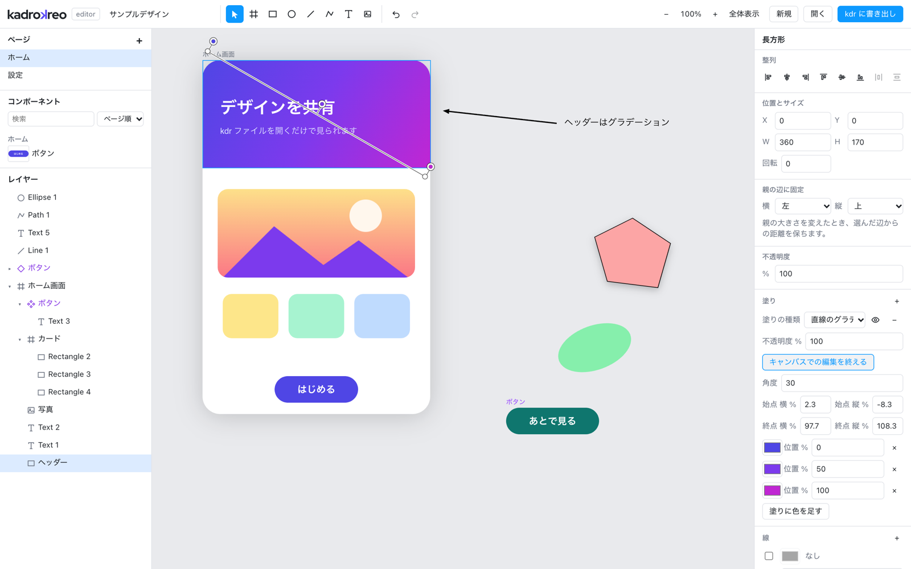

# kadrokreo

既存のオンラインデザインツールに近いデザインツール。



| editor（オートレイアウト） | viewer |
| --- | --- |
|  |  |

viewer は、デザインを実装する人のための表示（既存のデザインツールの開発者向けモードに当たる）を兼ねている。
図形を選ぶと設定と CSS が出て、別の図形にポインタを重ねると間隔が出る。


ほかのキャプチャは [`docs/captures/`](docs/captures/) にある（`npm run capture` で撮り直せる）。

## コンセプト

- **viewer モード**（既定）: kdr ファイルを読み込んで閲覧する。図形の設定・CSS・間隔を確かめられる。編集や変更はできない
- **editor モード**: Docker でオプションを付けて起動した場合のみ。kdr ファイルに書き出しができる
- コメント機能は存在しない
- kdr ファイルの実体は gzip 圧縮された 1 つの JSON ファイル

## 起動

```sh
docker build -t kadrokreo .

docker run --rm -p 8080:80 kadrokreo            # viewer モード
docker run --rm -p 8080:80 kadrokreo --editor   # editor モード
```

http://localhost:8080 を開く。

イメージには viewer と editor の 2 つのビルドが入っていて、`--editor` の有無でどちらを配信するかが決まる。
viewer として起動したコンテナからは、編集機能のコードそのものが配信されない。

## 使い方

### editor

| 操作 | 内容 |
| --- | --- |
| `V` / `F` / `R` / `O` / `L` / `P` / `T` | 選択 / フレーム / 長方形 / 楕円 / 直線 / ペン / テキスト |
| ドラッグ | 図形を描く、選択したものを動かす、何もない所からは範囲選択 |
| `Shift` + ドラッグ | 正方形・正円で描く、直線を 45° 刻みで引く、縦横比を保ってリサイズ、水平・垂直に動かす |
| `⌘`/`Ctrl` + ドラッグ | 吸着（スナップ）なしで動かす・リサイズする |
| 選択枠の上の丸をドラッグ | 回転（`Shift` で 15° 刻み）。角度はプロパティパネルでも指定できる |
| ダブルクリック / `Enter` | テキストを編集（`Esc` で確定） |
| `Space` + ドラッグ、ホイール | 画面の移動 |
| `⌘`/`Ctrl` + ホイール、ピンチ | ズーム |
| `Shift` + `1` / `Shift` + `0` | 全体を表示 / 100% |
| `⌘`/`Ctrl` + `Z` / `Shift` + `Z` | 元に戻す / やり直す |
| `⌘`/`Ctrl` + `C` / `X` / `V` / `D` | コピー / 切り取り / 貼り付け / 複製 |
| `]` / `[` | 最前面 / 最背面へ（`⌘`/`Ctrl` 併用で 1 つずつ） |
| 矢印キー | 1px 移動（`Shift` で 10px） |
| `Shift` + `A` | 選んだものを、自動で並べるフレームにまとめる |
| `⌘`/`Ctrl` + `Alt` + `K` | 選んだフレームをコンポーネントにする |
| `Delete` | 削除 |

- 図形をフレームの上へドラッグするとフレームの子になり、外へ出すとページ直下に戻る
- 動かす・リサイズするときは、近くの図形や親フレームの端・中央に吸着し、揃った位置に赤い線が出る
- プロパティパネルの「整列」で、複数選択なら選択範囲に、1 つなら親フレームに揃える。3 つ以上なら等間隔にも並べられる
- テキストはクリックで作ると幅が自動、ドラッグで作るかハンドルで幅を変えると、その幅で折り返す。
  太字、行揃え（左・中央・右）、行の高さを指定できる
- 直線は 1 本だけ選ぶと両端にハンドルが出て、端をつかんで向きと長さを変えられる
- ペンはクリックするたびに頂点を打つ（`Shift` で 45° 刻み）。`Enter` かダブルクリックで折れ線として確定し、
  最初の頂点をクリックすると閉じた多角形になる。描いたパスはダブルクリックすると頂点を動かせる（`Esc` で抜ける）
- 直線と折れ線の端には矢印を付けられる（プロパティパネルの「端の形」）
- 長方形・楕円・フレームには影を、長方形・フレーム・画像には角丸を付けられる
- 塗りはグラデーション（2 色、角度つき）にできる。画像は、枠と縦横比が違うときの収め方（枠を埋めて切り抜く・
  全体を収める・引き伸ばす）を選べる
- プロパティパネルの「書き出し」で、選択中のもの（何も選んでいなければ表示中のページ全体）を PNG に書き出せる。
  倍率は 1〜3 倍、背景は透明
- フレームは、プロパティパネルの「オートレイアウト」で中身を縦か横に自動で並べられる。間隔・余白・揃え方を指定でき、
  フレームの大きさは中身に合わせるか固定するかを選べる。中の図形はドラッグで順番を入れ替える。
  テキストを `Shift` + `A` でまとめて余白を付ければ、文字数に合わせて伸び縮みするボタンになる
- フレームは「コンポーネント」にできる。コンポーネント（元）からインスタンスを作って何か所にも置け、元を変えると
  すべてのインスタンスに反映される（別のページのものも）。元を複製・コピーして貼り付けてもインスタンスになる。
  元を消すと、インスタンスは中身を残してただのフレームになる
- インスタンスは、文言・塗り・線の色・表示だけを、そのインスタンスに限って変えられる（上書き）。
  中の文字をダブルクリックすると文言を打ち直せ、ほかの図形はダブルクリックで選んで色を変える。
  レイヤー一覧でインスタンスを開けば、中身を選んだり、目のアイコンで隠したりもできる。
  上書きした項目は元を変えても残り、それ以外は元に合わせて変わる。プロパティパネルのボタンで元と同じに戻せる。
  形や並びまで変えたいときは切り離す
- 回転は枠の中心が軸。フレームを回すと中身も一緒に回る。回したものは、その向きに沿ってリサイズできる。
  斜めに回ったものを含む複数選択をまとめてリサイズするときは、歪まないよう縦横比が固定される
- 画像（PNG / JPEG / WebP / GIF、16MB まで）はツールバーのボタン、ウィンドウへのドロップ、貼り付けで配置する。
  リサイズは縦横比を保つ（`Shift` で解除）
- ページ直下のフレームは、左上の名前ラベルをつかんで動かせる
- レイヤーパネルではドラッグで重なり順と親子関係を変えられる。名前はダブルクリックで変更
- ページは左上の一覧で追加・複製・削除・並べ替え（ドラッグ）・名前変更（ダブルクリック）ができる。
  ページごとに独立したキャンバスを持ち、コピー＆貼り付けでページをまたいで図形を移せる
- 編集中のドキュメントはブラウザ（IndexedDB）に自動保存される
- 「kdr に書き出し」でファイルに保存し、「開く」またはウィンドウへのドロップで読み込む

### viewer

「kdr を開く」またはウィンドウへのドロップで kdr ファイルを読み込む。ドラッグで画面を移動、`⌘`/`Ctrl` + ホイールでズーム。
左の一覧でページを切り替えられる。ページ直下のフレームも一覧に出て、押すとそのフレームが画面に収まる。
表示中のページ全体や、フレーム 1 つを PNG として保存できる（倍率は 1〜3 倍）。ドキュメントは変更されない。

viewer は、デザインを実装する人のための表示（既存のデザインツールの開発者向けモードに当たる）を兼ねていて、切り替えなしで次のことができる。

- キャンバスの図形をクリックすると選べる（ドラッグは画面の移動のまま）。左のレイヤー一覧からも選べる。
  コンポーネントのインスタンスの中身や、ロックしてある図形も選べる。何もない所のクリックか `Esc` で選択を外す
- 右のパネルに、選んだものの位置・大きさ・角丸・不透明度・塗り・線・影・文字の設定・オートレイアウトの設定が出る。
  値を押すと、その値がクリップボードにコピーされる
- 選んだものを CSS で表したものも出る（「CSS をコピー」でまとめてコピー）。ふつうのフレームの子は `position: absolute`、
  自動で並べるフレームは `display: flex` になる。直線とパスは CSS では描けないので、SVG に指定するプロパティで表す
- 選んだまま別の図形にポインタを重ねると、その図形との間隔が出る。親のフレームに重ねれば、4 辺までの余白が出る
- 選んだものだけを PNG として保存できる

どれも見ることと書き出すことだけで、ドキュメントは変更されない。

## kdr ファイル

次の JSON を gzip 圧縮したもの。

```json
{
  "format": "kadrokreo",
  "version": 10,
  "document": {
    "name": "Untitled",
    "pages": [
      {
        "id": "<id>",
        "name": "Page 1",
        "rootIds": ["..."],
        "nodes": { "<id>": { "type": "frame", "...": "..." } }
      }
    ],
    "assets": { "<id>": { "mime": "image/png", "data": "<base64>" } }
  }
}
```

ノードの定義は `src/document/types.ts`。読み込み時には `src/document/kdr.ts` で型・木構造・展開後のサイズを検証し、知らないフィールドは捨てる。
画像は base64 で `assets` に埋め込み、全ページで共有する。古い version のファイルも読み込める（足りない項目は、当時の見た目になる値で補う）。

| version | 増えたもの |
| --- | --- |
| 1 | フレーム、長方形、楕円、テキスト |
| 2 | 画像、テキストの折り返し |
| 3 | 直線、影、フレームと画像の角丸、テキストの太さ・行揃え・行の高さ |
| 4 | 複数ページ（3 までは `document` が直接 `nodes` と `rootIds` を持ち、1 ページとして読み込む） |
| 5 | 回転 |
| 6 | パス（折れ線・多角形）、線の端の矢印、直線の始点と終点の区別 |
| 7 | グラデーション、画像の収め方（6 までの画像は「引き伸ばす」として読み込む） |
| 8 | オートレイアウト |
| 9 | コンポーネント |
| 10 | インスタンスごとの上書き（文言・塗り・線の色・表示） |

## 構成

| パス | 内容 | viewer | editor |
| --- | --- | --- | --- |
| `src/document/` | ドキュメントの型、kdr の読み込みと検証 | ○ | ○ |
| `src/canvas/` | Canvas 2D での描画、ズーム・パン | ○ | ○ |
| `src/ui/` | 共通の UI 部品 | ○ | ○ |
| `src/viewer/` | viewer の画面（設定と CSS の表示、間隔の計測を含む） | ○ | |
| `src/editor/` | 編集操作、Undo/Redo、ツール、パネル、kdr の書き出し | | ○ |
| `docker/` | 配信用の nginx 設定と起動スクリプト | | |
| `e2e/` | ブラウザでの動作確認スクリプト | | |

viewer 側のディレクトリ（`document` / `canvas` / `ui` / `viewer`）から `src/editor/` を import すると lint エラーになる。
これにより viewer ビルドに編集機能が紛れ込まない。

## 開発

```sh
npm install
npm run dev          # viewer モード
npm run dev:editor   # editor モード（開発用。配布物では Docker の --editor のみ）
npm test
npm run lint
npm run build        # dist/viewer と dist/editor を出力
npm run e2e          # ブラウザでの動作確認（Google Chrome が必要）
npm run capture      # サンプルを組み立てて画面のキャプチャを撮る（e2e/out/captures に出る）
```

設計の要点、作業の経緯、次にやることは [`docs/HANDOVER.md`](docs/HANDOVER.md)（引き継ぎ資料）にまとめてある。

## 未対応

- 曲線（パスは直線でつなぐだけ）、頂点の追加と削除、矢印以外の端の形、反転
- グラデーションは 2 色の直線状だけ（3 色以上や円形は画面から作れない）。線やテキストには付けられない
- PNG 書き出しでは、影など枠の外にはみ出す部分は含まれない
- 回した図形への吸着（スナップ）は、囲む矩形の端と中央に対してだけ効く。影のずれは回転に従わない
- 画像の切り抜き位置の調整（切り抜くときは常に中央）
- テキストの禁則処理、1 つのテキストの中での部分的な装飾
- オートレイアウトの、子を親の幅いっぱいに伸ばす指定、折り返し、4 辺ばらばらの余白
- コンポーネントのバリアント、インスタンスごとの上書きのうち文言・塗り・線の色・表示以外（大きさ、書体、画像の差し替えなど）
