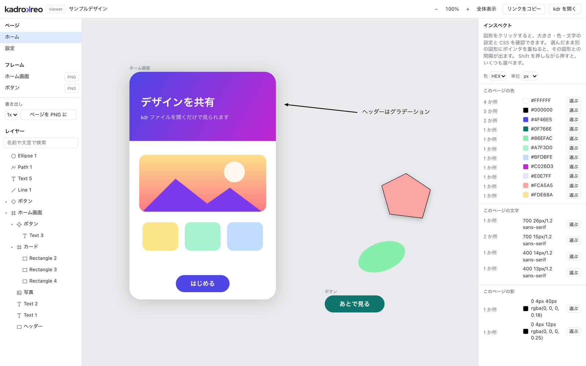
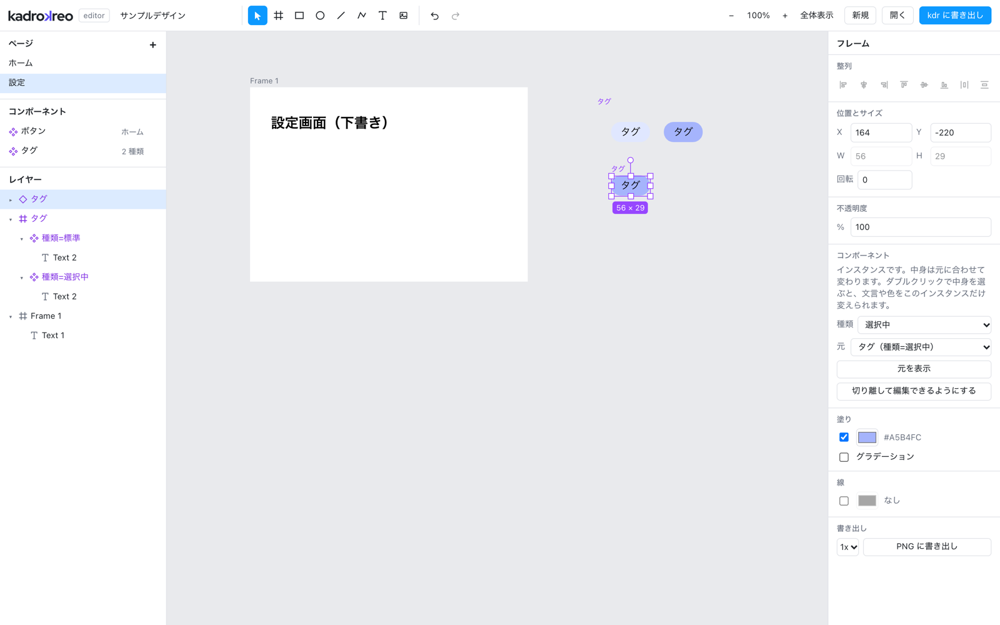

# kadrokreo


既存のオンラインデザインツールに近いデザインツール。


| editor（オートレイアウト） | viewer |
| --- | --- |
|  |  |

| editor（バリアント） |
| --- |
|  |

viewer は、デザインを実装する人のための表示（既存のデザインツールの開発者向けモードに当たる）を兼ねている。
図形を選ぶと設定と CSS が出て、別の図形にポインタを重ねると間隔が出る。


ほかのキャプチャは [`docs/captures/`](docs/captures/) にある。


## コンセプト

- **viewer モード**（既定）: kdr ファイルを読み込んで閲覧する。図形の設定・CSS・間隔を確かめられる。編集や変更はできない
- **editor モード**: Docker でオプションを付けて起動した場合のみ。kdr ファイルに書き出しができる
- コメント機能は存在しない
- kdr ファイルの実体は、ドキュメントの JSON と画像のファイルを tar にまとめて gzip 圧縮した 1 つのファイル（tar.gz）

## 起動

```sh
docker build -t kadrokreo .

docker run --rm -p 8080:80 kadrokreo            # viewer モード
docker run --rm -p 8080:80 kadrokreo --editor   # editor モード
docker run --rm -i -v "$PWD:/work" kadrokreo kdr --help   # kdr コマンド（下の「コマンドライン」）
```

http://localhost:8080 を開く。

イメージには viewer と editor の 2 つのビルドが入っていて、`--editor` の有無でどちらを配信するかが決まる。
viewer として起動したコンテナからは、編集機能のコードそのものが配信されない。
最初の引数を `kdr` にすると、配信はせずに kdr コマンドを実行して終わる（Node もイメージに入っているので、手元に Node は要らない）。

## 使い方

### editor

| 操作 | 内容 |
| --- | --- |
| `V` / `F` / `R` / `O` / `L` / `P` / `T` | 選択 / フレーム / 長方形 / 楕円 / 直線 / ペン / テキスト |
| ドラッグ | 図形を描く、選択したものを動かす（選択枠の内側の空いた所をつかんでもよい）、何もない所からは範囲選択 |
| `Shift` + ドラッグ | 正方形・正円で描く、直線を 45° 刻みで引く、縦横比を保ってリサイズ、水平・垂直に動かす |
| `⌘`/`Ctrl` + ドラッグ | 吸着（スナップ）なしで動かす・リサイズする |
| 選択枠の上の丸をドラッグ | 回転（`Shift` で 15° 刻み）。角度はプロパティパネルでも指定できる（複数で角度が揃っていれば、選択範囲の中心を軸にまとめて回る） |
| ダブルクリック / `Enter` | テキストを編集（`Esc` で確定） |
| `Space` + ドラッグ、ホイール | 画面の移動 |
| `⌘`/`Ctrl` + ホイール、ピンチ | ズーム |
| `Shift` + `1` / `Shift` + `2` / `Shift` + `0` | 全体を表示 / 選択へズーム / 100% |
| 右クリック | メニュー（コピー・貼り付け・複製・削除・重なり順・まとめる・コンポーネントにする・選択へズーム・別のページへ移す） |
| `⌘`/`Ctrl` + `Z` / `Shift` + `Z` | 元に戻す / やり直す |
| `⌘`/`Ctrl` + `C` / `X` / `V` / `D` | コピー / 切り取り / 貼り付け / 複製（元のすぐ上に入る） |
| `]` / `[` | 最前面 / 最背面へ（`⌘`/`Ctrl` 併用で 1 つずつ） |
| 矢印キー | 1px 移動（`Shift` で 10px） |
| `Shift` + `A` | 選んだものを、自動で並べるフレームにまとめる |
| `Shift` + `H` / `Shift` + `V` | 左右に反転 / 上下に反転（選択範囲の中心で裏返す。右クリックメニューにもある。テキストと画像は字や絵を裏返さず、位置と向きだけ） |
| `⌘`/`Ctrl` + `Alt` + `K` | 選んだフレームをコンポーネントにする |
| `Delete` | 削除 |

- 図形をフレームの上へドラッグするとフレームの子になり、外へ出すとページ直下に戻る
- 動かす・リサイズするときは、近くの図形や親フレームの端・中央に吸着し、揃った位置に赤い線が出る
- プロパティパネルの「整列」で、複数選択なら選択範囲に、1 つなら親フレームに揃える。3 つ以上なら等間隔にも並べられる
- テキストはクリックで作ると幅が自動、ドラッグで作るかハンドルで幅を変えると、その幅で折り返す（句読点や閉じ括弧を行頭に置かない禁則処理つき）。
  文字の太さ（100〜900。太字の切り替えボタンもある）、行揃え（左・中央・右）、行の高さを指定できる
- 直線は 1 本だけ選ぶと両端にハンドルが出て、端をつかんで向きと長さを変えられる（ペンで頂点を 2 つだけ置いた折れ線も直線になる）
- ペンはクリックするたびに頂点を打つ（`Shift` で 45° 刻み）。押したままドラッグすると、その頂点から曲線の制御点を引き出せる（既存のデザインツールと同じ）。
  `Enter` かダブルクリックで確定し、最初の頂点をクリックすると閉じた形になる。
- 描いたパスや直線はダブルクリックすると頂点の編集に入る（`Esc` で抜ける）。頂点をつかんで動かし、押して選ぶと制御点のハンドルが出る。
  なめらかな頂点の制御点は、反対側も一直線のまま回る（`Alt` を押しながらだと片側だけ。`Shift` で 45° 刻み）。
  頂点をダブルクリックすると角となめらかを切り替え、辺の上をダブルクリックすると形を変えずに頂点を足し、`Delete` で選んだ頂点を消す。
  頂点は空いた所からドラッグで囲むか `Shift` + クリックで複数選べ、つかんだ 1 つと一緒にまとめて動く（矢印キーでも動く。`Shift` で 10px）。
  穴のあるパス（SVG の取り込みや CLI で作ったもの）は、穴などの 2 つ目以降の輪郭の頂点も同じように選んで動かし、足し、消せる。輪郭の頂点を全部選んで `Delete` を押すと、その輪郭ごと消える。
  プロパティパネルの「パス」で、選んだ頂点の種類（角・なめらか）と角の丸めを変えられる（頂点を選んでいなければ全部の頂点の角の丸め）。
  辺を押すとその辺を選び、「この辺で開く」か `Delete` で、閉じた形をその辺で開いた線にする。
  頂点の編集中にペン（`P`）に持ち替えて描くと、新しいパスではなく、そのパスの輪郭（穴や離れた形）として描き足せる（確定すると頂点の編集に戻る）
- 長方形・楕円・パスをいくつか選んで「パスを結合」（`⌘`/`Ctrl` + `E`。右クリックメニューにもある）すると、最も背面のものの見た目の 1 つのパスにまとまる（それぞれが輪郭になる）。
  輪郭が 2 つ以上あるパスは「パスを分割」（`⌘`/`Ctrl` + `Shift` + `E`）で輪郭ごとのパスに分けられる
- 長方形・楕円・パスをいくつか選んで「ブーリアン演算（パスに焼き込む）」（右クリックメニュー）の合体（`Alt` + `Shift` + `U`）・差し引き（`Alt` + `Shift` + `S`）・交差（`Alt` + `Shift` + `I`）・除外（`Alt` + `Shift` + `X`）をかけると、
  結果の形の 1 つのパスになる（最も背面のものの見た目を引き継ぐ。差し引きは最も背面のものから手前のものを引く）。曲線は曲線のまま交点で切る。
  元の図形は残らない（Undo で戻せる）。結果が空になるときは何も変えずに知らせる
- 「ブーリアン演算（元を残す）」（右クリックメニュー）は、選んだもの（テキスト以外）を子に残したブーリアン演算のノードにまとめる（既存のデザインツールの Boolean groups）。
  ノードは結果の形を自分の塗り・線・効果で描き、子は描かない。演算はプロパティパネルの「ブーリアン演算」で変えられる。
  ダブルクリックで元の図形を選んで動かす・変えると、結果も変わる（ノードの枠は結果に付いてくる）。ノードを拡大すると子も一緒に拡大する。
  同じメニューの「平らにする」で結果の形のパスに焼き込める
- 線のある長方形・楕円・パス・ブーリアン演算のノードは「線の輪郭化」（`⌘`/`Ctrl` + `Alt` + `O`、右クリックメニュー）で、線の形を線の色で塗るパスにできる。
  塗りのある図形は線を外して残し、そのすぐ手前に「名前 の線」のパスを置く。破線・端の形も形になる（角はマイター、長すぎればベベル）
- 長方形・楕円・パスは「マスクとして使う」（`⌘`/`Ctrl` + `Alt` + `M`、右クリックメニュー、プロパティパネルの「マスク」）でマスクにできる。
  マスクは描かれず、同じ親の中で手前にあるものを、次のマスクまで切り取る。いくつか選んで使うと、それらをフレームにまとめて最も背面のものをマスクにする。マスクを隠すと何も切り取らない。
  プロパティパネルの「種類」で、形（塗りを見ない）・不透明度（塗りの不透明度やグラデーションの透明さで透かす）・明るさ（塗りの明るさで透かす。白は見え、黒は消える）を選べる
- 直線と折れ線の端の形は、なし・丸・四角（線の太さで決まる端）・矢印・丸の印・ひし形の印から選べる（プロパティパネルの「端の形」）。
  印の大きさは指定でき、空欄なら線の太さから決まる
- 線の欄の「破線」で破線にでき、破線の長さと間隔を指定できる（最初は 4px と 4px）。SVG から取り込んだ 3 つ以上の並びは「破線の並び」に `4, 2, 1, 2` のように書く
- どのノードにも効果（落ち影・内側の影・レイヤーのぼかし・背景のぼかし。影の欄の種類で選ぶ）を、長方形・フレーム・画像には角丸を付けられる。
  影は広がり（太らせる・負なら細らせる）と描画モード（影ごと。乗算など）も決められる。テキストにもすべての効果を付けられ（内側の影と背景のぼかしは文字の形の内側に付く）、画像の影は枠の形に付く。
  背景のぼかしは、図形の内側で後ろに見えているものをぼかす（塗りを半透明にすると見える）。角丸は 4 隅ばらばらにもできる（「角ごとに変える」）
- 塗り・線・影は「+」や「影を足す」で何枚でも重ねられる（上下の並べ替え・外すも各行のボタン）。
  塗りと線は単色・直線のグラデーション（角度か、始点・終点を自由に）・円形のグラデーション（中心と横・縦の半径）・
  角度のグラデーション（中心と始まりの角度）にでき、円形は楕円を回せる（「回す角度」）。
  グラデーションの色はいくつでも足せる（位置は %）。テキストの塗りもグラデーションにできる。
  塗りと線は 1 枚ずつ不透明度と描画モード（乗算・スクリーンなど）を持てる（行の「不透明度 %」「塗りの描画モード」。図形全体の不透明度とは別に重なる）。
  ノードそのものの描画モードは「不透明度」の欄で選ぶ（子を持つフレームは中身をまとめてから後ろに混ぜる。フレームは「通過」も選べ、半透明でも子がそれぞれ後ろと直接混ざる）。
  塗り・線・影の行の目のボタンで、消さずに隠せる（隠したものは描かず、viewer の CSS・SVG・色の一覧にも出ない）
- グラデーションの行の「キャンバスで動かす」か、グラデーションの図形のダブルクリックで、キャンバスの上のハンドルをつかんで動かせる。直線は始点・終点をつかむと
  中心のまわりに向きが変わり（`Shift` で 15° 刻み）、円形は中心と横・縦の半径の先をつかむ（`Shift` で縦横の半径を揃えて円にする）。
  色は線の横に並ぶ印をつかんで位置を動かし、線の上のダブルクリックで色を足し、`Delete` で選んだ色を消す。`Esc` で抜ける
- 画像は、枠と縦横比が違うときの収め方（枠を埋めて切り抜く・全体を収める・引き伸ばす）と、寄せる位置
  （横・縦の %。切り抜くときはどこを残すか、収めるときは余白の配り方）を選べる。「拡大 %」で切り抜きを拡大でき（100% 以上）、
  拡大した画像のどこを残すかも寄せる位置で決まる
- プロパティパネルの「書き出し」で、選択中のもの（何も選んでいなければ表示中のページ全体）を PNG か SVG に書き出せる。
  倍率は 1〜3 倍、背景は透明（書き出し欄の「背景」で色を敷ける。SVG も同じ）。範囲は影やぼかし・線の太さと角のとがり・枠からはみ出した行まで含む。「SVG をコピー」（右クリックメニューの「SVG としてコピー」も）で、同じ SVG をクリップボードへ入れられる。
  SVG は書き出し欄のチェックで、レイヤー名の id を付けるか・背景の色を敷くかを選べる（ブラウザに覚える。viewer も同じ）
- フレームは、プロパティパネルの「オートレイアウト」で中身を縦か横に自動で並べられる。間隔・余白・揃え方を指定でき、
  フレームの大きさは中身に合わせるか固定するかを選べる。中の図形はドラッグで順番を入れ替える。
  テキストを `Shift` + `A` でまとめて余白を付ければ、文字数に合わせて伸び縮みするボタンになる。
  余白は上・右・下・左を別々に指定できる
- 自動で並べるフレームの子は、プロパティパネルの「親いっぱいに伸ばす」で幅や高さを親に合わせて伸ばせる。
  並べる向きなら余った場所を分け合い、直交する向きなら余白の内側いっぱいになる（テキストは幅だけ。伸ばすと折り返す）。
  インスタンスも伸ばせ、中身は伸ばした大きさで並ぶ。viewer の CSS では `flex: 1 0 0` / `align-self: stretch` になる
- 自動で並べるフレームの子は、並べる向きの矢印キーで順番を入れ替えられる。「並びから外す」にすると、
  並びに加わらずに位置を自由に決められる（バッジやアイコンを角に重ねるときなど。CSS では `position: absolute`）
- 自動で並べるフレームは「収まらなければ折り返す」にすると、並べる向きに収まらない子を次の行へ送る（タグやカードの一覧など）。
  行と行の間隔は別に決められる。折り返すと並べる向きの大きさは固定になる。CSS では `flex-wrap: wrap`。
  「行の配置」を「均等に配る」にすると、行のまとまりを直交する向きに均等に配る（CSS では `align-content: space-between`）
- 並べないフレームの子と、並びから外した子は、「親の辺に固定」で親の大きさが変わったときの動き方を決められる
  （横は左・右・左右・中央・拡大縮小、縦は上・下・上下・中央・拡大縮小。既存のデザインツールの制約と同じ）。
  右下に貼ったバッジは、親を広げても右下に残る。CSS では `right` / `bottom`、左右なら `left` と `right`、拡大縮小なら割合で書く。
  回した子は、回した図形を囲む矩形で辺からの距離を測る（CSS では大きさは今のまま、中心が追従する位置で書く）。
  固定した子を 1 つ選ぶと、キャンバスに固定した親の辺へ破線（拡大縮小は点線、中央は親の中心線）が出る（左・上のままなら出ない）
- 大きさを自動で決める向き（親いっぱいに伸ばす・中身に合わせる）には、「大きさの下限・上限」で最小・最大の幅と高さを決められる。
  伸ばす子が上限に掛かると、余った分はほかの伸ばす子が分け合う。CSS では `min-width` / `max-width` など。
  幅を中身に合わせるテキストに最大の幅を決めると、それを超える行は最大の幅で折り返す。
  テキストの高さはいつも中身で決まるので、最小・最大の高さをいつも決められる（最大を超える行は枠の外へはみ出す。CSS の `max-height` と同じ）
- フレームは「コンポーネント」にできる。コンポーネント（元）からインスタンスを作って何か所にも置け、元を変えると
  すべてのインスタンスに反映される（別のページのものも）。元を複製・コピーして貼り付けてもインスタンスになる。
  元を消すと、インスタンスは中身を残してただのフレームになる
- 左のパネルの「コンポーネント」に、すべてのページの元が並ぶ。行を押すと画面の中央に、キャンバスへドラッグすると
  その位置にインスタンスを置ける（そこにフレームがあれば、その中へ入る。ドラッグ中は入る先のフレームを青い枠で示す）。行の右の「→」で元を表示する。
  一覧の上の欄で名前から絞り込め（バリアントの名前でも探せる）、ページ順・名前順に並べ替えられる。
  行には元の小さなサムネイルが付き、ページ順ではページが複数あればページごとの見出しが付く
- コンポーネントの元・インスタンス・その中身は紫で見分けられる（キャンバスのフレーム名と選択枠、レイヤー一覧。viewer も同じ）
- インスタンスを選ぶと、プロパティパネルの「元」で別のコンポーネントに差し替えられる。
  上書きは、新しい元の中にレイヤー名のたどり方が同じノードがあれば引き継ぐ
- 元の「バリアントを追加」で、同じ部品の別の形（大・小、標準・押下など）を作れる。元は自動で並べるフレーム（まとまり）に包まれ、
  元の名前はまとまりの名前に、元には `種類=標準`、複製には `種類=2` のような名前が付く。名前の「プロパティ=値」がそのままバリアントの
  プロパティになる（`サイズ=大, 状態=押下` のように、カンマで区切っていくつでも持てる）。
  バリアントのインスタンスを選ぶと、プロパティごとの選択欄で別のバリアントに切り替えられる（上書きは差し替えと同じく引き継ぐ）。
  まとまりを選ぶとプロパティ名を変えたり、「プロパティを追加」や「×」ですべてのバリアントの名前にプロパティを足したり外したりでき、
  「↑」「↓」でプロパティの順を変えられる。プロパティの下には値の一覧が出て、値の名前を変える（その値のバリアントすべてが変わる）・
  順を変える（バリアントの並びが値の順になる）・「値を追加」（最初のバリアントを複製してその値にする）ができる。
  バリアントを選ぶと値を変えられる。値が `true` / `false` だけのプロパティはチェック欄で出る。まとまりはキャンバスで紫の破線に囲まれる。
  コンポーネントの一覧では、まとまりを 1 行にまとめ、「▸」で開くとバリアントを選んで置ける。
  バリアントをキャンバスやレイヤー一覧でまとまりの外へ動かすと、ふつうのコンポーネントになり、名前は `ボタン（大, 押下）` のようにまとまりの名前と値をつないだものになる。
  逆に、ほかのバリアントがあるまとまりへ元を入れると、まとまりのプロパティの形の名前（ない値は最初のバリアントの値、重なれば新しい値）が付いてバリアントになる。
  まとまりには説明文を付けられる（バリアントのインスタンスを選ぶと出る）。
  kdr に専用の項目はなく（まとまりの説明文を除く）、名前とフレームの入れ子だけで表している（既存のデザインツールと同じ名前の付け方）
- インスタンスは、文言・塗り・線の色・表示・文字の書式（大きさ・太さ・書体）・画像だけを、そのインスタンスに限って変えられる（上書き）。
  中の文字をダブルクリックすると文言を打ち直せ、ほかの図形はダブルクリックで選んで色を変える。
  レイヤー一覧でインスタンスを開けば、中身を選んだり、目のアイコンで隠したりもできる。
  上書きした項目は元を変えても残り、それ以外は元に合わせて変わる。プロパティパネルのボタンで元と同じに戻せる。
  中身を選ぶと「元と違えている項目」が出て、「元に反映」でその値を元に書き込める（ほかのインスタンスにも入る）。
  インスタンスを選んで「上書きを元に反映」なら、そのインスタンスの上書きをすべて元に書き込む。
  プロパティパネルでは、元と違う値にしている欄（塗り・線・文字の大きさなど）に紫の点が付く
- 元の中に別のコンポーネントのインスタンスを置いてあれば、インスタンスの中のその写しを選び、「元」で別のコンポーネントに差し替えられる
  （このインスタンスに限った上書き。元に反映すると、元の中のインスタンスが差し替わる）。そのまた中のインスタンス（入れ子の中の入れ子）も同じように差し替えられる
- 元には説明文を付けられ、インスタンスを選ぶと説明が出る（コンポーネントの一覧では名前にポインタを重ねると出る）。
  元の中のノードを選ぶと「コンポーネントのプロパティ」の節で、文言・表示・入れ子のインスタンスの元をプロパティにできる（既存のデザインツールのコンポーネントプロパティ）。
  インスタンスでは、プロパティごとの欄（文字の欄・チェック欄・元の選択欄）で値を選べる。値は結んだノードへの上書きとして入るので、
  元に反映・元と同じに戻すもふつうの上書きと同じように効く。1 つのプロパティに複数のノードを結べる（「既存に結ぶ」）。
  元の中に置いた入れ子のインスタンスの中の文字や図形（写し）にも、文言・表示を結べる（カードの中のボタンの文言をカードのプロパティにするなど）。
  そのまた中のインスタンス（カードの中のボタンの中のアイコンなど、入れ子の中の入れ子）にも、差し替えを結べる。
  元がバリアントなら、プロパティはまとまりのすべてのバリアントで共有する（足す・名前を変える・並べ替える・候補・消すがすべてのバリアントにかかり、
  結ぶノードはほかのバリアントでもレイヤー名のたどり方が同じものに結ぶ）。増やしたバリアントもプロパティを受け継ぐ。
  外から入れた元などでバリアントのプロパティが揃っていなければ、まとまりを選ぶと「プロパティを揃える」で一度に揃えられる。
  元の「プロパティ」の一覧では「↑」「↓」で順を変えられ（インスタンスの欄もその順）、差し替えのプロパティには「候補」（既存のデザインツールの preferred values）を選べる。
  候補を選んでおくと、インスタンスの元の選択欄の先頭に「候補」としてまとめて出る（ほかのコンポーネントも「そのほか」から選べる）
- 画像はプロパティパネルの「画像を差し替え」で別のファイルに替えられる（大きさと収め方はそのまま）
  形や並びまで変えたいときは切り離す
- 回転は枠の中心が軸。フレームを回すと中身も一緒に回る。回したものは、その向きに沿ってリサイズできる。
  斜めに回ったものを含む複数選択をまとめてリサイズするときは、歪まないよう縦横比が固定される
- 画像（PNG / JPEG / WebP / GIF、32MB まで）はツールバーのボタン、ウィンドウへのドロップ、貼り付けで配置する。
  リサイズは縦横比を保つ（`Shift` で解除）
- SVG は画像としてではなく、図形に変換して取り込む（同じボタンや「開く」、ドロップ、貼り付け。デザインツールで「SVG としてコピー」した文字も貼れる）。
  SVG 全体が 1 つのフレームに、`g` は入れ子のフレームになり、取り込んだあとは普通の図形として編集できる。
  輪郭が複数の `path`（穴）と `fill-rule`、破線（`stroke-dasharray`）、`<style>` の CSS（単純なセレクタ）、`clip-path` / `mask`（矩形・円は切り取るフレームに、ほかの形はマスクのパスになる。グラデーションで塗った図形 1 つの `mask` と `mask-type: alpha` は明るさ・不透明度のマスクになる）、
  data URI の `<image>`（画像になる）も写す。スクリプトや外部への参照は読まず、表せないもの（フィルタ・複雑なマスクなど）は置き換えるか読み飛ばして、何を落としたかを知らせる
- ページ直下のフレームは、左上の名前ラベルをつかんで動かせる
- レイヤーパネルではドラッグで重なり順と親子関係を変えられる。名前はダブルクリックで変更。
  `Shift` を押して押すと、最後に押した行からの範囲を選び、`⌘`/`Ctrl` を押して押すと 1 行ずつ足し外しする
- ページは左上の一覧で追加・複製・削除・並べ替え（ドラッグ）・名前変更（ダブルクリック）ができる。
  ページごとに独立したキャンバスを持ち、右クリックメニューの「別のページへ移す」で図形をほかのページへ移せる（コピー＆貼り付けと違い、コンポーネントの元は元のまま）
- 編集中のドキュメントはブラウザ（IndexedDB）に自動保存される
- 「kdr に書き出し」でファイルに保存し、「開く」またはウィンドウへのドロップで読み込む

### viewer

「kdr を開く」またはウィンドウへのドロップで kdr ファイルを読み込む。ドラッグで画面を移動、`⌘`/`Ctrl` + ホイールでズーム。
左の一覧でページを切り替えられる。ページ直下のフレームも一覧に出て、押すとそのフレームが画面に収まる。
表示中のページ全体や、フレーム 1 つを PNG（倍率は 1〜3 倍）か SVG として保存できる。「SVG をコピー」で SVG の文字をクリップボードへ入れることもできる。背景（PNG と SVG）と SVG の id は書き出し欄のチェックで選べる。ドキュメントは変更されない。

viewer は、デザインを実装する人のための表示（既存のデザインツールの開発者向けモードに当たる）を兼ねていて、切り替えなしで次のことができる。

- キャンバスの図形をクリックすると選べる（ドラッグは画面の移動のまま）。ページ直下のフレームは、名前のラベルでも選べる。
  コンポーネントのインスタンスの中身や、ロックしてある図形も選べる。何もない所のクリックか `Esc` で選択を外す
- 左のレイヤー一覧からも選べる。画面に入っていないものを選ぶと、見える位置まで画面が動く。
  一覧の上の欄に打ち込むと、名前やテキストの内容で探せる（`Esc` で元の一覧に戻る）
- 選んだあとは、キーボードでレイヤーの木に沿って動ける: `Enter` で子へ、`Shift` + `Enter` で親へ、
  `Tab` / `Shift` + `Tab` で隣のきょうだいへ
- 右のパネルに、選んだものの位置・大きさ・角丸・不透明度・塗り・線・影・文字の設定・オートレイアウトの設定が出る。
  値を押すと、その値がクリップボードにコピーされる
- コンポーネントのインスタンスを選ぶと、元と違えている項目（文言・塗りなど）が、どの中身のものか分かる。
  中身を選んだときは、そのノードが違えている項目が出る。「元のコンポーネントへ移動」で元を選べる（別のページにあれば、そのページへ切り替わる）。
  元の説明文とプロパティ（元では種類と結んだノード、インスタンスではいまの値）も出る
- 選んだものを CSS で表したものも出る（「CSS をコピー」でまとめてコピー）。ふつうのフレームの子は `position: absolute`、
  自動で並べるフレームは `display: flex` になる。直線とパスは CSS では描けないので、SVG に指定するプロパティで表す
  （HTML ではパスを SVG の `path` の `d` で出し、曲線は `C`。グラデーションの塗り・線は `linearGradient` / `radialGradient`）。
  パネルの上の欄で、色の書き方（HEX / RGB / HSL）と長さの単位（px / rem）を切り替えられる。rem の基準（1rem が何 px か、既定は 16）も変えられる。
  色の書き方は、設定の一覧・CSS・ページの色の一覧のすべてに効く
- 同じ欄の「形式」で、コードの出し方を HTML + CSS・React（`style`）・React（CSS Modules）・React（Tailwind のクラス）・Vue（単一ファイルコンポーネント）から選べる。
  React の形式では、1 つのノードの欄が `style` のオブジェクトか Tailwind のクラスになり、子孫までまとめたものは JSX のコンポーネント（名前はレイヤー名から）になる。
  CSS Modules なら `styles.クラス名` を付けた JSX と、その CSS が出る。Tailwind は決まったクラスがあればそれを使い、なければ `[プロパティ:値]` で書く。
  Vue では、子孫までまとめたものが `<template>` と `<style scoped>` を並べた `.vue` ファイルの中身になる（1 つのノードの欄は CSS のまま）。
  形式も、選び直したり選択を外したりしてもそのまま（ブラウザには保存しない）
- 中身のあるフレームを選ぶと、子孫までまとめた HTML と CSS も出る（要素のクラス名はレイヤー名から作る。非表示のものは含めない）。
  画像を埋め込んだ HTML ファイルとして保存すれば、そのままブラウザで開いて見比べられる（ファイルは形式によらず HTML + CSS）。
  線は描画と同じく枠の辺の上に引き（CSS では `outline` と負の `outline-offset`）、直線・折れ線の端の形（矢印・印など）と頂点の角の丸めも SVG で出る
- キャンバスをダブルクリックすると、そこにあるフレームが画面に収まる
- 選んだまま別の図形にポインタを重ねると、その図形との間隔が出る。親のフレームに重ねれば、4 辺までの余白が出る。
  上下（左右）に離れていれば、その向きの間隔だけが出る。線は 2 つが重なっている範囲の中央を通る
  回した図形どうしは、向きが同じ（90° の倍数の違いも含む）なら辺に沿って測る。向きが違えば、回した図形を囲む矩形（破線で出る）どうしを測る
- `Shift` を押しながら押すと、いくつも選べる（キャンバスでもレイヤー一覧でも。もう一度押すと外れる）。
  2 つ選ぶと、その間隔がキャンバスとパネルに出る。パネルには全体を囲む矩形の位置と大きさも出て、まとめて PNG・SVG に書き出せる
- 選んだものだけを PNG・SVG として保存できる。画像を選んでいれば、埋め込んである元のファイルもそのまま保存できる
- 何も選んでいないときは、そのページで使われている色と、文字の設定（CSS の `font` に書ける形）の一覧が出る。
  これも押すとコピーされる。横の「選ぶ」で、その色や文字の設定を使っている図形をまとめて選べる。
  影を使っていれば、影の一覧（CSS の `box-shadow` の値）も出る。
  色は見えているものだけを数える。塗りを重ねていれば、不透明な塗りの下に隠れた色は数えない（図形が半透明なら、下の塗りも透けて見えるので数える）。
  隠れた色は一覧に出ないので、確かめるときは図形を選んでインスペクトの「塗り」を見る（重ねた塗りを全部出す）
- 見ているページと選んでいるものは、アドレスのハッシュ（`#page=…&select=…`）に入る。「リンクをコピー」で渡せば、
  受け取った人がそのアドレスを開いて同じ kdr を開いたときに、そのページと選択から始まる（kdr そのものは URL に入らない）

どれも見ることと書き出すことだけで、ドキュメントは変更されない。

### コマンドライン

`kdr` は、kdr ファイルを調べたり編集したりするコマンドライン（長い名前の `kadrokreo` でも動く）。自動化やエージェントから kdr を組み立てる・書き換えるためのもの。
Docker のイメージから使う（下の「Docker で使う」）か、リポジトリを手元に置いて Node 24 以降で動かす（`npm install` と `npm link` で `kdr` が PATH に入る。
`npm link` をしなくても `./cli/kadrokreo.ts` で同じように動く）。

```sh
npm link        # kdr と kadrokreo を PATH に置く（npm unlink -g kadrokreo で外す）

kdr [-f 入力.kdr] [-o 出力.kdr | -w] コマンド 引数… [+ コマンド 引数…]…
```

- `+` だけの引数でコマンドを区切ると、1 回の実行で左から順に実行する
- 入力は `-f`（省略すると標準入力）、先頭が `new` なら新しいドキュメント
- 出力は `-o`、`-w` なら入力のファイルへ上書き。どちらもなく、ドキュメントを変えたときは kdr を標準出力へ出すので、パイプでつなげられる
- `ls` などの文字の出力は標準出力へ出る（kdr と同時に標準出力へは出せないので、そのときは `-o` を指定する）
- ノードは id、レイヤー名、`親/子` の道筋（名前か id を `/` でつなぐ）、`@`（直前に作ったノード）で指す

```sh
# 新しく作る（+ でつなぐ）
kdr new Demo \
  + add frame --name Card --id card --width 320 --height 200 fill=#f5f5ff cornerRadius=12 \
  + add frame --name Button --id btn --parent card fill=#5b4cf5 cornerRadius=8 \
  + add text --parent btn --name Label --text OK fill=#ffffff \
  + auto-layout btn padding=12 + component btn \
  -o demo.kdr

# パイプでつなぐ。インスタンスの中身を変えると、editor と同じく上書きとして覚える
kdr -f demo.kdr instance Button --id btn2 --parent card --x 120 \
  | kdr set btn2/Label text=Cancel -o demo2.kdr

# 調べる
kdr -f demo2.kdr info + ls
kdr -f demo2.kdr css btn2
kdr -f demo2.kdr html card --standalone > card.html
kdr -f demo2.kdr html card --format tailwind   # React（Tailwind）の JSX。react / css-modules / vue も

# PNG に書き出す（viewer の PNG 書き出しと同じ絵・同じファイル名）
kdr -f demo2.kdr png                       # ページ全体 → 「Demo - Page 1.png」
kdr -f demo2.kdr png Card --scale 2        # フレーム（ノード）1 つを 2 倍で → 「Card@2x.png」
kdr -f demo2.kdr png btn btn2 --each --to out   # ノードごとに out/ へ
kdr -f demo2.kdr png Card --to - > card.png     # 標準出力へ

# SVG に書き出す（viewer の SVG 書き出しと同じもの。取り込みの svg とは逆向き）
kdr -f demo2.kdr svg-out                   # ページ全体 → 「Demo - Page 1.svg」
kdr -f demo2.kdr svg-out Card --to card.svg
kdr -f demo2.kdr svg-out Card --no-ids --background '#ffffff' --to -   # id なし・白い背景で標準出力へ

# 上書き保存
kdr -f demo2.kdr -w set Card fill=#ffffff

# グラデーション（3 色、真ん中の位置は 30%、塗りの不透明度 80%）と、バリアントのプロパティ
kdr -f demo2.kdr -w gradient linear Card --colors '#5b4cf5,#a99fff@30%,#ffffff' --angle 90 --opacity 0.8
kdr -f demo2.kdr -w variant-add Button --id big 種類=大 + variant-prop-add big サイズ M + variant-prop-rename big 種類 スタイル
```

| コマンド | 内容 |
| --- | --- |
| `new [名前]` | 新しいドキュメント（先頭にだけ置ける） |
| `info` / `ls [ノード] [--all] [--json]` / `get ノード [項目]` / `find 文字列` / `bounds ノード` | 調べる（`get パス d` は形を SVG の path の d で出す） |
| `css ノード` / `html ノード [--standalone]` / `json [--pretty]` / `components` | viewer のインスペクトと同じ CSS・HTML、kdr の `document.json` の中身、コンポーネントの一覧。`css` と `html` は `--format html\|react\|css-modules\|tailwind\|vue` で viewer のコードの形式と同じものを出す |
| `page ページ` / `page-add 名前` / `page-rename 名前` / `page-rm [ページ]` / `doc-name 名前` | ページとドキュメント |
| `add 種類 …` | `rect` `ellipse` `frame` `text`（`--text`）`line`（`--from x,y --to x,y`）`path`（`--points "x,y …" [--closed]` か、曲線を含めるなら SVG の path の `--d "M0 0 C…"`。`M` のまとまりが複数なら穴のあるパス）`image`（`--src 画像`） |
| `set ノード… 名前=値…` | 設定を変える（`fill=#ff0000`、`shadow.blur=4`、`layout.gap=8`、`sizing.width=fill`、`maxWidth=320`、`constraints.horizontal=end`、`fill=null` で外す）。`fill` / `stroke` / `shadow` は、単色の塗り・線と最初の影の略記（`shadow.spread=4` で影の広がり）。`blur=8` / `backgroundBlur=8` でレイヤー・背景のぼかし（`null` で外す）、`blendMode=multiply` でノードの描画モード。`cornerRadius=8,8,0,0` で角丸を 4 隅ばらばらに（左上・右上・右下・左下）。パスは `radius=8` で頂点の角を丸める（頂点ごとなら `radius=8,0,8`）。破線は `dash=4,2`（線の長さ・間隔。`dash=null` で実線）。端の形は `endCap=arrow`（`none` `round` `square` `arrow` `circle` `diamond`）、印の大きさは `capSize=16`。配列は `fills=[…]` と JSON で書くか、`fills.0.color=#ff0000` のように番号でつなぐ |
| `gradient linear\|radial\|conic ノード… [--colors 色,色@50%,色…] [--angle 度] [--from x,y --to x,y] [--center x,y] [--radius r\|rx,ry] [--opacity 0〜1] [--blend 描画モード] [--hidden] [--stroke] [--index N \| --add]` | グラデーションの塗りにする（3 色以上、位置は 0〜1 か %）。直線は `--angle` か始点・終点（`--from` / `--to`）、円形の `--angle` は楕円を回す角度、角度（conic）は `--center` と `--angle`（最初の色の向き）。`--blend multiply` で塗りの描画モード。ふつうはいちばん上の塗りを置き換え、`--index` で何番目か（0 が一番下）、`--add` で上に重ねる。`--stroke` なら線。`--hidden` でその塗りを隠す。`--colors` を省くと今の色のまま種類や向きだけ変える。塗り・影を隠すだけなら `set ノード fills.0.visible=false`、内側の影は `set ノード shadow.type=inner-shadow` |
| `rm` / `mv (--parent フレーム \| --root)` / `order front\|back\|forward\|backward` / `dup` | 削除、親の付け替え、重なり順、複製 |
| `boolean union\|subtract\|intersect\|exclude ノード… [--keep]` / `flatten ノード…` | ブーリアン演算（合体・差し引き・交差・除外）。矩形・楕円・パスの塗りの形にかけ、最も背面のものを引き継いだ 1 つのパス（`fillRule=evenodd`）にする。差し引きは最も背面のものから残りを引く。`--keep` なら元の図形を子に残すブーリアン演算のノードにまとめる（演算は `set ノード booleanOperation=intersect` で変えられる）。`flatten` はそのノードを結果のパスに焼き込む |
| `outline-stroke ノード…` | 線の輪郭化（線の形を線の色で塗るパスにする。塗りのある図形は残して手前に置く） |
| `join ノード…` / `split パス…` / `mask ノード… [--name 名前] [--type vector\|alpha\|luminance]` | パスの結合（矩形・楕円・パスを 1 つのパスの輪郭に）と分割（輪郭ごとのパスに）、マスクとして使う（いくつもならフレームにまとめる。どれもマスクならやめる。`--type` は形・不透明度・明るさのマスク。`set ノード isMask=true maskType=luminance` でも変えられる） |
| `align left\|center\|right\|top\|middle\|bottom ノード…` / `distribute horizontal\|vertical ノード…` / `rotate 度 ノード… [--each \| --pivot x,y]` / `flip horizontal\|vertical ノード…` | 整列（1 つなら親に揃える）、等間隔、回転（いまの角度に足す。軸はふつう全体の中心）、反転（全体の中心で裏返す） |
| `auto-layout フレーム [--off] [direction=… gap=… padding=… wrap=true crossGap=… alignContent=space-between sizing.width=fixed]` / `wrap ノード…` / `layout-fill width\|height ノード…` | オートレイアウト（`wrap=true` は折り返し。`wrap` コマンドはまとめる操作で別物） |
| `component フレーム` / `detach フレーム` / `instance 元 [--parent フレーム]` / `swap インスタンス 元` | コンポーネント（`swap` は元の差し替え。インスタンスの中の入れ子のインスタンスも） |
| `override-push ノード…` / `override-reset ノード…` | インスタンスの上書きを元に反映する・捨てて元に戻す |
| `variant-add 元 [プロパティ=値…]` / `variant インスタンス… プロパティ=値…` | バリアントを増やす・インスタンスのバリアントを選ぶ（プロパティ名は日本語でもよい） |
| `variant-prop-add まとまり 名前 [値]` / `variant-prop-rename まとまり 名前 新しい名前` / `variant-prop-rm まとまり 名前` / `variant-value-rename まとまり プロパティ 値 新しい値` | バリアントのプロパティを足す・名前を変える・消す、値の名前を変える（すべてのバリアントの名前を書き換える。まとまりの代わりに中のバリアントを指してもよい） |
| `describe 元\|まとまり 説明文` / `prop-add 元 text\|boolean\|instance ノード… [--name 名前]` / `prop インスタンス… 名前=値…` | コンポーネント（またはバリアントのまとまり）の説明文、プロパティを作って元の中のノードに結ぶ、インスタンスのプロパティの値を決める |
| `prop-rename 元 名前 新しい名前` / `prop-order 元 名前 位置` / `prop-prefer 元 名前 [候補の元…]` / `prop-rm 元 名前` / `prop-align まとまり` | 元のプロパティの名前を変える・並べ替える（0 が先頭）・差し替えの候補を決める・消す（元がバリアントなら、まとまりのすべてのバリアントで揃える）、揃っていないバリアントのプロパティを一度に揃える |
| `svg ファイル.svg [--parent フレーム] [--x N --y N]` | SVG を図形のノードに変換して置く（表せずに落としたものは標準エラーに出る） |
| `png [ノード…] [--scale 2] [--to ファイル.png\|-] [--each] [--background 色]` | PNG に書き出す。ノードなしならページ全体、ノード（いくつでも）ならそれらを囲む範囲。`--to` を省くと viewer と同じ名前で今のディレクトリへ。`--each` はノードごとのファイル（`--to` はディレクトリ）。`--background` は背景の色を敷く（既定は透明）。ドキュメントは変えない |
| `svg-out [ノード…] [--to ファイル.svg\|-] [--each] [--no-ids] [--background 色]` | SVG に書き出す。範囲・ファイル名・`--to`・`--each` は `png` と同じ（倍率はない）。`--no-ids` はレイヤー名の id を付けない、`--background` は背景の色を敷く。テキストの折り返しと基線は見積もりで決める。ドキュメントは変えない |

すべてのコマンドの説明は `kdr --help`、1 つだけなら `kdr help add`。

#### Docker で使う

イメージの最初の引数を `kdr` にすると、kdr コマンドとして動く。手元のディレクトリを `/work` につなぐと、ファイルの相対パスはそこから数える。

```sh
docker build -t kadrokreo .

# 手元のファイルを読み書きする（--user を付けると、書き出したファイルの持ち主が自分になる）
docker run --rm -v "$PWD:/work" --user "$(id -u):$(id -g)" kadrokreo kdr new Demo + add rect --name Box -o demo.kdr
docker run --rm -v "$PWD:/work" --user "$(id -u):$(id -g)" kadrokreo kdr -f demo.kdr ls

# パイプでつなぐときは -i を付ける（標準入力を渡すため）。-t は付けない（kdr を端末へは出さない）
docker run --rm -i kadrokreo kdr new | docker run --rm -i kadrokreo kdr add rect --name Box > demo.kdr

# PNG も書き出せる（イメージに描画のライブラリと日本語の書体が入っている）
docker run --rm -v "$PWD:/work" --user "$(id -u):$(id -g)" kadrokreo kdr -f demo.kdr png --scale 2
docker run --rm -i kadrokreo kdr -f - png --to - < demo.kdr > page.png
```

毎回書くのが長ければ、シェルの関数にしておくと手元の `kdr` と同じように使える。

```sh
kdr() { docker run --rm -i -v "$PWD:/work" --user "$(id -u):$(id -g)" kadrokreo kdr "$@"; }
```

- 終了コード（0 成功・1 エラー・2 使い方の誤り）とエラーの表示は、そのまま `docker run` の結果になる
- `/work` の外（親ディレクトリや絶対パス）のファイルは、コンテナからは見えない。必要なら `-v` で別につなぐ
- コンテナの中では `kdr`（と `kadrokreo`）が PATH にあるので、`--entrypoint sh` で入ってスクリプトから呼ぶこともできる

まとまった例として、スマホ画面（375×812）のワイヤーフレームを組み立てるスクリプトを [`docs/examples/wireframe.sh`](docs/examples/wireframe.sh) に置いている
（`sh docs/examples/wireframe.sh 出力.kdr`。`kdr` が PATH になければ、リポジトリの `cli/kadrokreo.ts` を使う）。
オートレイアウトで区画を並べ、リストの行をコンポーネントにしてインスタンスで増やす、という組み立て方の見本になっている。

- 変更のたびに editor と同じ後始末（自動で並べ直す・インスタンスを元に合わせる・インスタンスへの変更を上書きとして覚える）をし、
  kdr として読み込める形かを確かめる。壊れた値（`fill=red` など）はエラーにして、何も書き出さない
- テキストの大きさ（`ls` の幅など）は、環境で結果が変わらないよう見積もる（英数字はブラウザの sans-serif と同じ字幅の表、全角は 1 文字 1em）。editor で文字を変えれば測り直される
- `png` は viewer / editor と同じ描画を Node 用の Canvas（[`@napi-rs/canvas`](https://www.npmjs.com/package/@napi-rs/canvas)）で行う。
  任意の依存なので、入っていない環境（`npm install --omit=optional` など）では `png` だけがエラーになる。Docker のイメージには入っている。
  文字は手元の書体で描く（macOS は Helvetica とヒラギノ、Docker のイメージは Liberation Sans と Noto Sans CJK）ので、ブラウザで書き出したものと文字の細部が少し違うことがある

## kdr ファイル

kadrokreo のデザインを保存するファイル（拡張子 `.kdr`）。中身はドキュメントの JSON（`document.json`）と画像の元のファイル（`assets/`）を
tar にまとめて gzip で圧縮したもの（version 16）で、`tar -xzf design.kdr` でそのまま取り出せる。

- 読めるのは今の version（16）のファイルだけ。古い version のファイルは「古いバージョン」として開かない
- 取り出したものを固め直すときは、`tar --format ustar` で `document.json` と `assets/` の中だけを入れる（macOS の tar が足す拡張の見出しや `._` のファイルがあると読めない）
- `document.json` の中身は `kdr -f design.kdr json --pretty` でも見られる。形の詳しい説明は [`docs/handover/kdr-format.md`](docs/handover/kdr-format.md)

## 未対応

- 線に沿う文字（`textPath`）、テキストをブーリアン演算・マスクに入れること。破線のずれ（`stroke-dashoffset`）と線の角の形（`stroke-linejoin`）
- マスクの当たり判定は、不透明度・明るさのマスクでも形で決める
- SVG の取り込みで表せないもの（図形がいくつもあるグラデーションのマスク（形だけかける）、フィルタ、`textPath`（文字はまっすぐ並べる）、外部の画像、複雑な CSS のセレクタ、`stroke-linejoin`・`stroke-dashoffset`、円形のグラデーションの焦点と回した楕円の向き）
- SVG 書き出しのフォントは埋め込まず名前だけ（開く環境に書体がなければ別の書体になる）。文字の基線の位置は見積もり
- 回した図形への吸着（スナップ）は、囲む矩形の端と中央に対してだけ効く。影のずれは回転に従わない
- viewer の CSS の切り抜きの拡大は `object-view-box` で出す（対応していないブラウザでは拡大されない）
- 1 つのテキストの中での部分的な装飾
- インスタンスごとの上書きのうち形や並びに関わるもの（大きさ、位置、行の高さ、行揃えなど）

## 開発する人へ

開発環境・確認（`npm run check`）・設計・作業の約束は [`docs/HANDOVER.md`](docs/HANDOVER.md)（引き継ぎ資料の入口）から辿れる。
コマンドと確認の手順は [`docs/handover/dev.md`](docs/handover/dev.md)、ディレクトリ構成と設計は [`docs/handover/design.md`](docs/handover/design.md)、作業の経緯は [`docs/HISTORY.md`](docs/HISTORY.md)。
