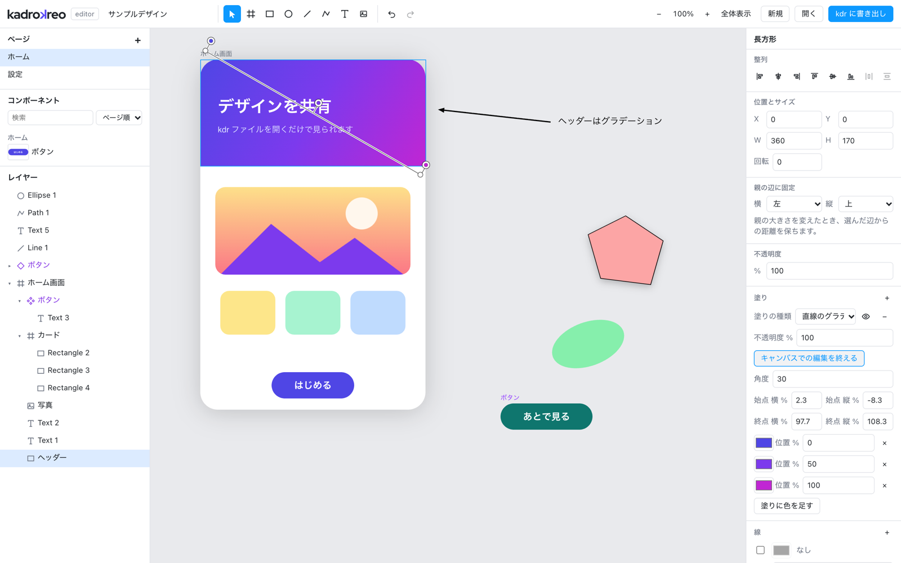
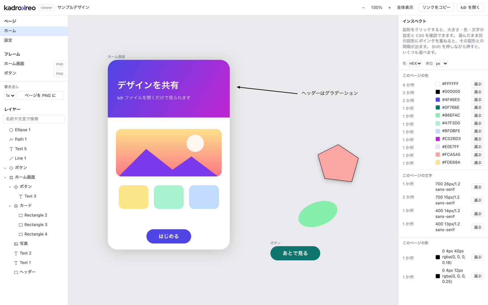

# ユーザーズガイド

kadrokreo の使い方。起動のしかたと、画面・コマンドごとの操作方法をまとめている。

| ページ | 中身 |
| --- | --- |
| [editor](editor.md) | 図形を描く・編集する（操作の一覧、パス、塗りと効果、オートレイアウト、コンポーネントとバリアント、書き出し、保存） |
| [viewer](viewer.md) | kdr ファイルを開いて見る。実装する人のための表示（設定・CSS・間隔・コード） |
| [コマンドライン](cli.md) | kdr コマンドで kdr ファイルを調べる・組み立てる・書き換える。Docker のイメージからの使い方、AI エージェントから使う（`kdr docs`・skill） |
| [kdr ファイル](kdr-file.md) | デザインを保存するファイルの中身と、取り出し方・固め直し方 |
| [未対応](limitations.md) | 今はできないこと |

## データの扱い

- kdr ファイルはブラウザの中で読み書きし、サーバーへ送らない。editor の編集中の内容も、ブラウザ（IndexedDB）に自動保存する
- 外部への通信はしない。Docker で配信するときは、CSP で読み込み・通信の先を自分自身だけに絞っている
- viewer の「リンクをコピー」で渡すアドレスに入るのは、見ているページと選んでいるものだけ（kdr そのものは URL に入らない）

## 起動

```sh
docker pull ghcr.io/yosiopp/kadrokreo:latest

docker run --rm -p 8080:80 ghcr.io/yosiopp/kadrokreo            # viewer モード
docker run --rm -p 8080:80 ghcr.io/yosiopp/kadrokreo --editor   # editor モード
docker run --rm -i -v "$PWD:/work" --user "$(id -u):$(id -g)" ghcr.io/yosiopp/kadrokreo kdr --help   # kdr コマンド（「コマンドライン」）
```

http://localhost:8080 を開く。

イメージは GitHub Container Registry の `ghcr.io/yosiopp/kadrokreo`。タグは `latest`（最新のリリース）が既定で、版を固定するなら `0.1.0`（`0.1` で 0.1 系の最新）、main の最新の状態は `edge`。
ソースから手元でビルドしたイメージ（`docker build -t kadrokreo .`、[CONTRIBUTING.md](../../CONTRIBUTING.md#ソースからイメージをビルドする)）も同じように使える。このガイドの例の `ghcr.io/yosiopp/kadrokreo` を `kadrokreo` に読み替える。

イメージには viewer と editor の 2 つのビルドが入っていて、`--editor` の有無でどちらを配信するかが決まる。
viewer として起動したコンテナからは、編集機能のコードそのものが配信されない。
最初の引数を `kdr` にすると、配信はせずに kdr コマンドを実行して終わる（Node もイメージに入っているので、手元に Node は要らない）。

| editor | viewer |
| --- | --- |
|  |  |
