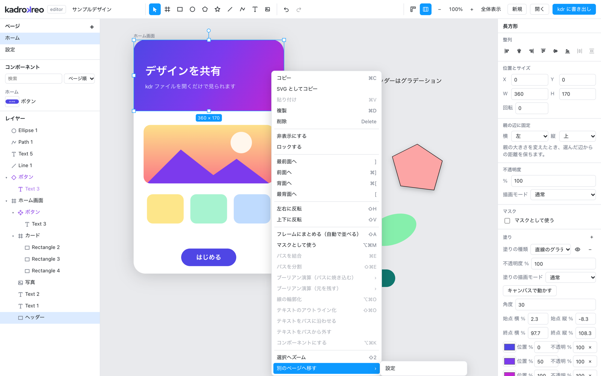
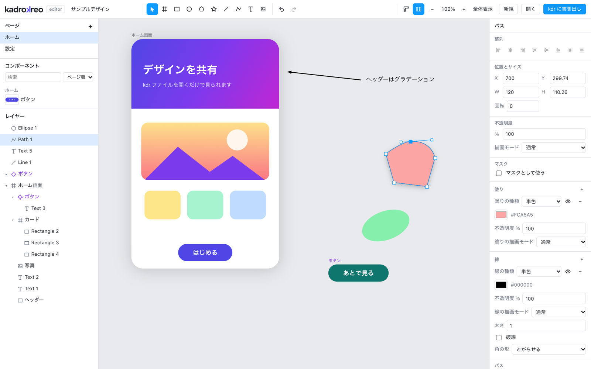
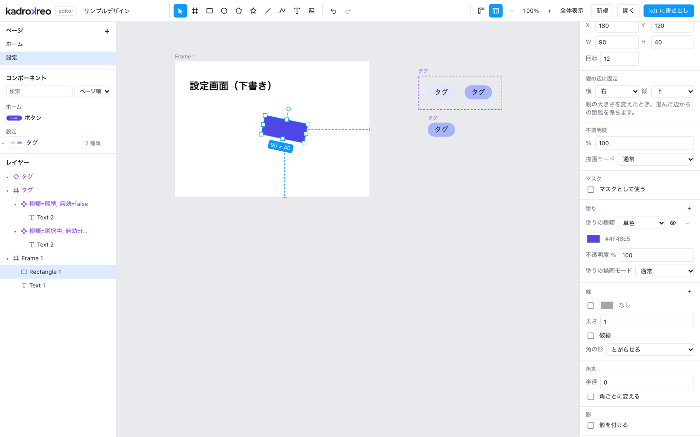
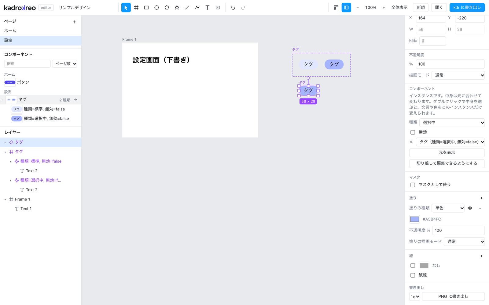
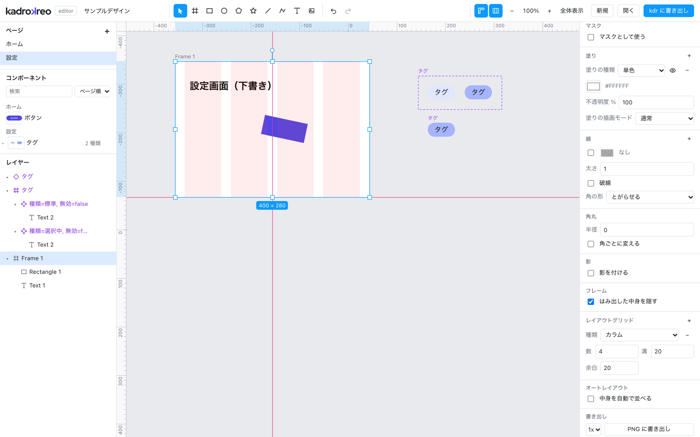
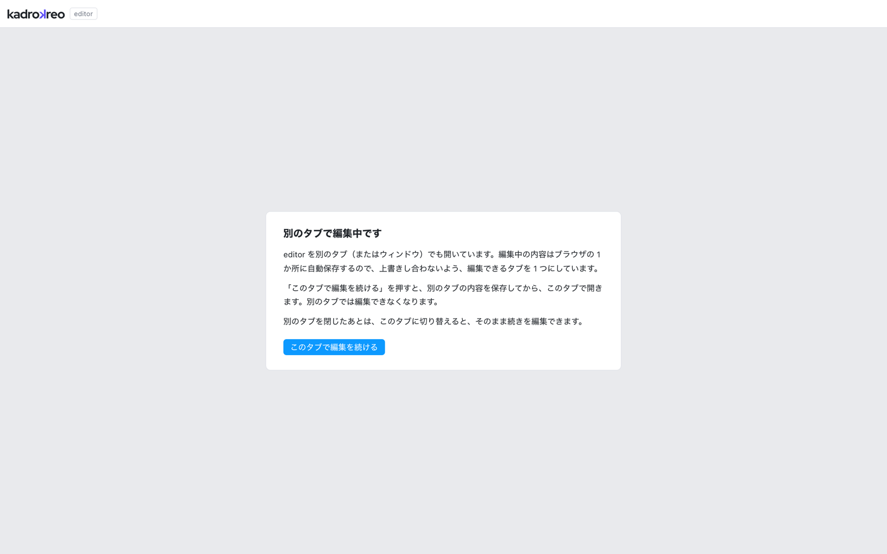
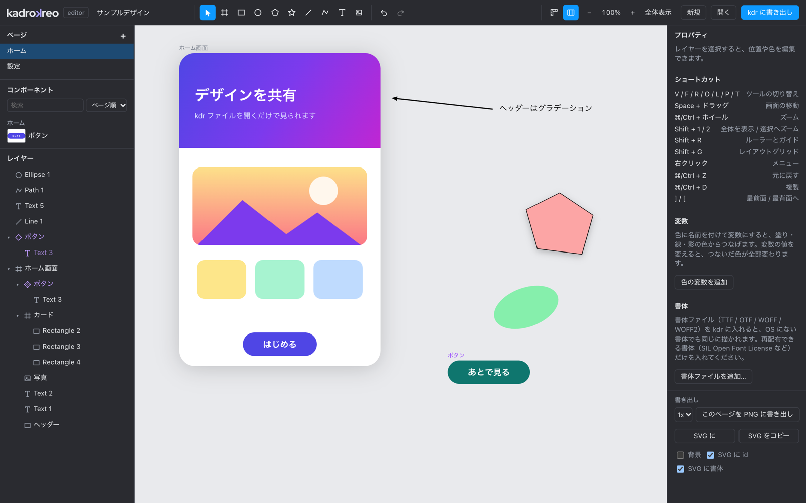

# editor

[ユーザーズガイド](README.md) の一部。editor は Docker で `--editor` を付けて起動したときだけ使える（起動のしかたは [入口](README.md#起動)）。
ドキュメントを作って編集し、kdr ファイルに書き出す。

## 操作の一覧

| 操作 | 内容 |
| --- | --- |
| `V` / `F` / `R` / `O` / `L` / `P` / `T` | 選択 / フレーム / 長方形 / 楕円 / 直線 / ペン / テキスト |
| ドラッグ | 図形を描く、選択したものを動かす（選択枠の内側の空いた所をつかんでもよい）、何もない所からは範囲選択 |
| `Shift` + ドラッグ | 正方形・正円で描く、直線を 45° 刻みで引く、縦横比を保ってリサイズ、水平・垂直に動かす |
| `⌘`/`Ctrl` + ドラッグ | 吸着（スナップ）なしで動かす・リサイズする |
| 選択枠の上の丸をドラッグ | 回転（`Shift` で 15° 刻み）。角度はプロパティパネルでも指定できる（複数で角度が揃っていれば、選択範囲の中心を軸にまとめて回る） |
| ダブルクリック / `Enter` | テキストを編集（`Esc` で確定） |
| `Space` + ドラッグ、ホイール | 画面の移動 |
| `⌘`/`Ctrl` + ホイール、ピンチ | ズーム（縮めて画面上で読めないほど小さくなった文字は、文字色の薄い帯で表す。拡大すれば文字に戻る。書き出す PNG には文字のまま入る） |
| `Shift` + `1` / `Shift` + `2` / `Shift` + `0` | 全体を表示 / 選択へズーム / 100% |
| 右クリック | メニュー（コピー・貼り付け・複製・削除・表示 / 非表示・ロック / ロック解除・重なり順・まとめる・コンポーネントにする・選択へズーム・別のページへ移す）。レイヤーパネルの行でも同じメニューが出る |
| `⌘`/`Ctrl` + `Z` / `Shift` + `Z` | 元に戻す / やり直す |
| `⌘`/`Ctrl` + `C` / `X` / `V` / `D` | コピー / 切り取り / 貼り付け / 複製（元のすぐ上に入る） |
| `]` / `[` | 最前面 / 最背面へ（`⌘`/`Ctrl` 併用で 1 つずつ） |
| 矢印キー | 1px 移動（`Shift` で 10px） |
| `Shift` + `A` | 選んだものを、自動で並べるフレームにまとめる |
| `Shift` + `H` / `Shift` + `V` | 左右に反転 / 上下に反転（選択範囲の中心で裏返す。右クリックメニューにもある。テキストと画像は字や絵そのものを鏡に映す。インスタンスは中身の配置も鏡に映し、元を変えても映ったまま追う。自動で並べるフレームの並びの順は入れ替えない） |
| `Alt` + `Shift` + `U` / `S` / `I` / `X` | 元の図形を残すブーリアン演算（合体 / 差し引き / 交差 / 除外）のノードにまとめる |
| `⌘`/`Ctrl` + `Alt` + `Shift` + `U` / `S` / `I` / `X` | ブーリアン演算（合体 / 差し引き / 交差 / 除外）をかけて 1 つのパスに焼き込む |
| `⌘`/`Ctrl` + `Shift` + `O` | テキストのアウトライン化（kdr に埋め込んだ書体のテキストを、文字の形のパスにする） |
| `⌘`/`Ctrl` + `Alt` + `K` | 選んだフレームをコンポーネントにする |
| `Shift` + `R` | ルーラーとガイド線の表示 / 非表示（[ルーラー・ガイド線・レイアウトグリッド](#ルーラーガイド線レイアウトグリッド)） |
| `Shift` + `G` | レイアウトグリッドの表示 / 非表示 |
| `Delete` | 削除 |

## 図形とテキスト

- 図形をフレームの上へドラッグするとフレームの子になり、外へ出すとページ直下に戻る
- ツールバーの「多角形」「星」で、正多角形と星を描ける（キーの割り当てはない）。選ぶとツールバーに「頂点の数」（星は「先の数」と「内側 %」＝内側の頂点の半径の、先に対する割合）の欄が出て、
  次に描く形を決める（3〜100。既定は三角形と、先が 5 つで内側 38% の星）。ドラッグした枠いっぱいに広がり、`Shift` を押すと正しい形の縦横比になる。クリックだけなら幅 100 の正しい形で置く。
  描いたものはふつうのパス（名前は「Polygon 1」「Star 1」）なので、頂点の編集・ブーリアン演算・書き出しはほかのパスと同じ。頂点の数は後から変えられない（描き直す）
- 動かす・リサイズするときは、近くの図形や親フレームの端・中央に吸着し、揃った位置に赤い線が出る
- プロパティパネルの「整列」で、複数選択なら選択範囲に、1 つなら親フレームに揃える。3 つ以上なら等間隔にも並べられる
- テキストはクリックで作ると幅が自動、ドラッグで作るかハンドルで幅を変えると、その幅で折り返す（句読点や閉じ括弧を行頭に置かない禁則処理つき）。
  文字の太さ（100〜900。太字の切り替えボタンもある）、行揃え（左・中央・右）、行の高さ、字間（px。負の値で詰める）、装飾（下線・取り消し線）を指定できる。
  字間は 1 文字ごとに後ろへ足すので（CSS の `letter-spacing` と同じく最後の文字の後ろにも）、幅が自動のテキストは字間の分だけ広がる
- 直線は 1 本だけ選ぶと両端にハンドルが出て、端をつかんで向きと長さを変えられる（ペンで頂点を 2 つだけ置いた折れ線も直線になる）

## ペンとパスの編集

- ペンはクリックするたびに頂点を打つ（`Shift` で 45° 刻み）。押したままドラッグすると、その頂点から曲線の制御点を引き出せる（既存のデザインツールと同じ）。
  `Enter` かダブルクリックで確定し、最初の頂点をクリックすると閉じた形になる。
- 描いたパスや直線はダブルクリックすると頂点の編集に入る（`Esc` で抜ける）。頂点をつかんで動かし、押して選ぶと制御点のハンドルが出る。
  なめらかな頂点の制御点は、反対側も一直線のまま回る（`Alt` を押しながらだと片側だけ。`Shift` で 45° 刻み）。
  頂点をダブルクリックすると角となめらかを切り替え、辺の上をダブルクリックすると形を変えずに頂点を足し、`Delete` で選んだ頂点を消す。
  頂点は空いた所からドラッグで囲むか `Shift` + クリックで複数選べ、つかんだ 1 つと一緒にまとめて動く（矢印キーでも動く。`Shift` で 10px）。
  穴のあるパス（SVG の取り込みや CLI で作ったもの）は、穴などの 2 つ目以降の輪郭の頂点も同じように選んで動かし、足し、消せる。輪郭の頂点を全部選んで `Delete` を押すと、その輪郭ごと消える。
  プロパティパネルの「パス」で、選んだ頂点の種類（角・なめらか）と角の丸めを変えられる（頂点を選んでいなければ全部の頂点の角の丸め）。
  辺を押すとその辺を選び、「この辺で開く」か `Delete` で、閉じた形をその辺で開いた線にする。
  頂点の編集中にペン（`P`）に持ち替えて描くと、新しいパスではなく、そのパスの輪郭（穴や離れた形）として描き足せる（確定すると頂点の編集に戻る）

## パスの結合・ブーリアン演算・線の輪郭化・テキストのアウトライン化・パスに沿う文字・マスク

- 長方形・楕円・パスをいくつか選んで「パスを結合」（`⌘`/`Ctrl` + `E`。右クリックメニューにもある）すると、最も背面のものの見た目の 1 つのパスにまとまる（それぞれが輪郭になる）。
  輪郭が 2 つ以上あるパスは「パスを分割」（`⌘`/`Ctrl` + `Shift` + `E`）で輪郭ごとのパスに分けられる
- 長方形・楕円・パス（と、kdr に埋め込んだ書体のテキスト）をいくつか選んで「ブーリアン演算（パスに焼き込む）」（右クリックメニュー）の合体（`⌘`/`Ctrl` + `Alt` + `Shift` + `U`）・差し引き（`S`）・交差（`I`）・除外（`X`）をかけると、
  結果の形の 1 つのパスになる（最も背面のものの見た目を引き継ぐ。差し引きは最も背面のものから手前のものを引く）。曲線は曲線のまま交点で切る。
  元の図形は残らない（Undo で戻せる）。結果が空になるときは何も変えずに知らせる
- 「ブーリアン演算（元を残す）」（右クリックメニュー。合体 `Alt` + `Shift` + `U`・差し引き `S`・交差 `I`・除外 `X`）は、選んだものを子に残したブーリアン演算のノードにまとめる（既存のデザインツールの Boolean groups）。
  テキストは、kdr に埋め込んだ書体（下の「書体」）で描くものだけが文字の形で入る（文字を書き換えると結果も変わる）。埋め込んでいない書体のテキストは文字の形が分からないので入らず、そう知らせる。
  ノードは結果の形を自分の塗り・線・効果で描き、子は描かない。演算はプロパティパネルの「ブーリアン演算」で変えられる。
  同じ欄の「線を含める」を入れると、子の線の外形（線の輪郭化と同じ形）も演算に入る（直線を合体する・線の太さで切り抜くときに使う）。
  ダブルクリックで元の図形を選んで動かす・変えると、結果も変わる（ノードの枠は結果に付いてくる）。ノードを拡大すると子も一緒に拡大する。
  同じメニューの「平らにする」で結果の形のパスに焼き込める
- 線のある長方形・楕円・パス・ブーリアン演算のノードは「線の輪郭化」（`⌘`/`Ctrl` + `Alt` + `O`、右クリックメニュー）で、線の形を線の色で塗るパスにできる。
  塗りのある図形は線を外して残し、そのすぐ手前に「名前 の線」のパスを置く。破線（ずれも）・端の形・線の角の形も形になる（とがらせる角は、長すぎれば切り落とす）。曲線は曲線のパスになる
- テキストは「テキストのアウトライン化」（`⌘`/`Ctrl` + `Shift` + `O`、右クリックメニュー）で、同じ名前・塗り・効果のまま文字の形のパスにできる（文字はもう書き換えられない。Undo で戻せる）。
  字の形は kdr に埋め込んだ書体のファイルから読むので、埋め込んでいない書体のテキストはそのままにして、書体ファイルを足すよう知らせる。
  書体に無い文字（画面では OS の書体で補って描いている文字）は形にできないので除き、その数を知らせる。
- テキストと、長方形・楕円・パス・ブーリアン演算のノードを 1 つずつ選んで「テキストをパスに沿わせる」（右クリックメニュー）を押すと、テキストがその図形の線（最初の輪郭）に沿って並ぶ（SVG の textPath と同じ置き方。文字の基線を線に乗せ、1 文字ずつ線の向きに回す）。
  線の形はテキストが写して持つので、元の図形は残り、後で動かしたり消したりしてもテキストは変わらない。テキストの枠は線を囲む矩形になり、拡大すると線も一緒に伸縮する。
  改行は空白として 1 行に並べ、線からはみ出した文字は描かない。プロパティパネルの「パスの始まり（%）」で並べ始める位置を、行揃えでその位置に並びの始まり・真ん中・終わりのどれを合わせるかを変えられる。「パスから外す」でふつうのテキストに戻る。
  SVG の書き出しでは `<textPath>` で書き、`<textPath>` を含む SVG を取り込むと線に沿うテキストになる
- 長方形・楕円・パス・テキスト・画像・フレームは「マスクとして使う」（`⌘`/`Ctrl` + `Alt` + `M`、右クリックメニュー、プロパティパネルの「マスク」）でマスクにできる（ブーリアン演算のノードはできない）。
  マスクは描かれず、同じ親の中で手前にあるものを、次のマスクまで切り取る。いくつか選んで使うと、それらをフレームにまとめて最も背面のものをマスクにする。マスクを隠すと何も切り取らない。
  プロパティパネルの「種類」で、形（塗りを見ない。テキストは文字の形、画像・フレームは角丸を含む枠の形）・不透明度（塗りの不透明度やグラデーション・画像の透明さで透かす）・明るさ（塗りの明るさで透かす。白は見え、黒は消える）を選べる。
  フレームの不透明度・明るさのマスクは、フレームの塗りと子を描いた絵で透かす（フレームの線と影は見ない）

## 線の端の形・角の形と破線

- 直線と折れ線の端の形は、なし・丸・四角（線の太さで決まる端）・矢印・丸の印・ひし形の印から選べる（プロパティパネルの「端の形」）。
  印の大きさは指定でき、空欄なら線の太さから決まる
- 線の欄の「破線」で破線にでき、破線の長さと間隔を指定できる（最初は 4px と 4px）。SVG から取り込んだ 3 つ以上の並びは「破線の並び」に `4, 2, 1, 2` のように書く。
  「破線のずれ」で並びを始める位置をずらせる（SVG・CSS の `stroke-dashoffset` と同じ。正の値で並びが線の向きと逆へずれる）
  両端の形が同じ丸か四角なら、破線の 1 本ごとの両端もその形になる（SVG・CSS の `stroke-linecap` と同じ）。両端の形が違えば、破線の切れ目は切りっぱなし
- 線の欄の「角の形」で、線の角をとがらせる・丸・切り落とすから選べる（SVG・CSS の `stroke-linejoin`。楕円と直線には角がないので出ない）

## 効果・角丸・塗り・線

- どのノードにも効果（落ち影・内側の影・レイヤーのぼかし・背景のぼかし。影の欄の種類で選ぶ）を、長方形・フレーム・画像には角丸を付けられる。
  影は広がり（太らせる・負なら細らせる）と描画モード（影ごと。乗算など）も決められる。テキストにもすべての効果を付けられ（内側の影と背景のぼかしは文字の形の内側に付く）、画像の影は枠の形に付く。
  背景のぼかしは、図形の内側で後ろに見えているものをぼかす（塗りを半透明にすると見える）。角丸は 4 隅ばらばらにもできる（「角ごとに変える」）
- 塗り・線・影は「+」や「影を足す」で何枚でも重ねられる（上下の並べ替え・外すも各行のボタン）。
  塗りと線は単色・直線のグラデーション（角度か、始点・終点を自由に）・円形のグラデーション（中心と横・縦の半径）・
  角度のグラデーション（中心と始まりの角度）にでき、円形は楕円を回せる（「回す角度」）。円形は焦点（色が始まる点）を中心からずらせる（「焦点 横 %」「焦点 縦 %」。半径に対する割合で、楕円の中に限る）。
  グラデーションの色はいくつでも足せる（位置は %）。色ごとに不透明度も持てる（透明に抜けていくグラデーション）。テキストの塗りもグラデーションにできる。
  塗りと線は 1 枚ずつ不透明度と描画モード（乗算・スクリーンなど）を持てる（行の「不透明度 %」「塗りの描画モード」。図形全体の不透明度とは別に重なる）。
  ノードそのものの描画モードは「不透明度」の欄で選ぶ（子を持つフレームは中身をまとめてから後ろに混ぜる。フレームは「通過」も選べ、半透明でも子がそれぞれ後ろと直接混ざる）。
  塗り・線・影の行の目のボタンで、消さずに隠せる（隠したものは描かず、viewer の CSS・SVG・色の一覧にも出ない）
- グラデーションの行の「キャンバスで動かす」か、グラデーションの図形のダブルクリックで、キャンバスの上のハンドルをつかんで動かせる。直線は始点・終点をつかむと
  中心のまわりに向きが変わり（`Shift` で 15° 刻み）、円形は中心と横・縦の半径の先をつかむ（`Shift` で縦横の半径を揃えて円にする）。焦点をずらしてあれば焦点もつかめる（`Shift` で軸の上に置く）。
  色は線の横に並ぶ印をつかんで位置を動かし、線の上のダブルクリックで色を足し、`Delete` で選んだ色を消す。`Esc` で抜ける

## 画像

- 画像（PNG / JPEG / WebP / GIF、32MB・6,400 万画素まで）はツールバーのボタン、ウィンドウへのドロップ、貼り付けで配置する。
  リサイズは縦横比を保つ（`Shift` で解除）
- 画像は、枠と縦横比が違うときの収め方（枠を埋めて切り抜く・全体を収める・引き伸ばす）と、寄せる位置
  （横・縦の %。切り抜くときはどこを残すか、収めるときは余白の配り方）を選べる。「拡大 %」で切り抜きを拡大でき（100% 以上）、
  拡大した画像のどこを残すかも寄せる位置で決まる
- テキストと画像は、プロパティパネルの「裏返し」（左右・上下）で字や絵そのものを鏡に映せる（枠の位置と大きさは変わらない。影の向きは裏返らない）。
  viewer の CSS では `transform: scale(-1, 1)` になり、PNG・SVG の書き出しも同じ見た目になる
- 画像はプロパティパネルの「画像を差し替え」で別のファイルに替えられる（大きさと収め方はそのまま）

## 書体

- テキストを選んでプロパティパネルの「書体ファイルを追加…」を押すと、書体ファイル（TTF / OTF / WOFF / WOFF2、32MB まで）を kdr に埋め込み、そのテキストの書体にする。
  埋め込んだ書体は「書体」の一覧の「kdr に埋め込んだ書体」から選べ、OS にない書体でも同じに描かれる（viewer・PNG と SVG の書き出し・viewer の HTML・[コマンドライン](cli.md) の `png` と `svg-out` も同じ）
- 書体名・太さ・斜体は書体ファイルから読む。同じ書体名・太さ・斜体の書体をもう一度入れると、ファイルを差し替える
- 何も選んでいないときのプロパティパネルの「書体」に、埋め込んだ書体の一覧が出る。ここでも追加でき、ゴミ箱のボタンで外せる（外すと、その書体のテキストは OS の書体で描かれる）
- 入れるのは再配布できる書体（SIL Open Font License など）だけにする。kdr を渡すと書体ファイルも一緒に渡る。書体ファイルは手を加えずにそのまま入れる

## 変数

- 色に名前を付けて変数（デザイントークン）にできる。何も選んでいないときのプロパティパネルの「変数」で「色の変数を追加」を押すと、表に行が増える。
  名前の `/` はグループの区切り（`color/primary`）。名前・色は表の中で変える
- 塗り・線・グラデーションの色・影の行の「〜の変数」で変数を選ぶと、その色が変数につながる。変数の値を変えると、つないだ色が全部変わる。
  色を直接選び直すとつながりは外れる。変数を消しても、つないだ色は今の値のまま残る
- 変数は「コレクション」（変数のまとまり）に入る。「モードを追加」で `Light` / `Dark` のようなモードを足すと、変数はモードごとに値を持つ。
  表の値の横の選択で、同じ種類の別の変数を指す別名にもできる。ページ・フレームで使うモードの指定は、いまは[コマンドライン](cli.md) の `kdr mode` で決める
- viewer のコードでは、変数につないだ色が `var(--color-primary)` で出る（[viewer](viewer.md#実装する人のための表示)）

## 書き出し

- プロパティパネルの「書き出し」で、選択中のもの（何も選んでいなければ表示中のページ全体）を PNG か SVG に書き出せる。
  倍率は 1〜3 倍、背景は透明（書き出し欄の「背景」で色を敷ける。SVG も同じ）。範囲は影やぼかし・線の太さと角のとがり・枠からはみ出した行まで含む。「SVG をコピー」（右クリックメニューの「SVG としてコピー」も）で、同じ SVG をクリップボードへ入れられる。
  SVG は書き出し欄のチェックで、レイヤー名の id を付けるか・背景の色を敷くか・kdr に埋め込んだ書体を入れるか（「SVG に書体」。テキストが使う書体のファイルをそのまま `@font-face` で入れる）を選べる（ブラウザに覚える。viewer も同じ）

## オートレイアウト

- フレームは、プロパティパネルの「オートレイアウト」で中身を縦か横に自動で並べられる。間隔・余白・揃え方を指定でき、
  フレームの大きさは中身に合わせるか固定するかを選べる。中の図形はドラッグで順番を入れ替える。
  テキストを `Shift` + `A` でまとめて余白を付ければ、文字数に合わせて伸び縮みするボタンになる。
  余白は上・右・下・左を別々に指定できる
- 自動で並べるフレームの子は、プロパティパネルの「親いっぱいに伸ばす」で幅や高さを親に合わせて伸ばせる。
  並べる向きなら余った場所を分け合い、直交する向きなら余白の内側いっぱいになる（テキストは幅だけ。伸ばすと折り返す）。
  インスタンスも伸ばせ、中身は伸ばした大きさで並ぶ。viewer の CSS では `flex: 1 0 0` / `align-self: stretch` になる
- 自動で並べるフレームの子は、並べる向きの矢印キーで順番を入れ替えられる。「並びから外す」にすると、
  並びに加わらずに位置を自由に決められる（バッジやアイコンを角に重ねるときなど。CSS では `position: absolute`）
- 自動で並べるフレームは「収まらなければ折り返す」にすると、並べる向きに収まらない子を次の行へ送る（タグやカードの一覧など）。
  行と行の間隔は別に決められる。折り返すと並べる向きの大きさは固定になる。CSS では `flex-wrap: wrap`。
  「行の配置」を「均等に配る」にすると、行のまとまりを直交する向きに均等に配る（CSS では `align-content: space-between`）

## 親の辺に固定と、大きさの下限・上限

- 並べないフレームの子と、並びから外した子は、「親の辺に固定」で親の大きさが変わったときの動き方を決められる
  （横は左・右・左右・中央・拡大縮小、縦は上・下・上下・中央・拡大縮小。既存のデザインツールの制約と同じ）。
  右下に貼ったバッジは、親を広げても右下に残る。CSS では `right` / `bottom`、左右なら `left` と `right`、拡大縮小なら割合で書く。
  回した子は、回した図形を囲む矩形で辺からの距離を測る（CSS では大きさは今のまま、中心が追従する位置で書く）。
  固定した子を 1 つ選ぶと、キャンバスに固定した親の辺へ破線（拡大縮小は点線、中央は親の中心線）が出る（左・上のままなら出ない）
- 大きさを自動で決める向き（親いっぱいに伸ばす・中身に合わせる）には、「大きさの下限・上限」で最小・最大の幅と高さを決められる。
  伸ばす子が上限に掛かると、余った分はほかの伸ばす子が分け合う。CSS では `min-width` / `max-width` など。
  幅を中身に合わせるテキストに最大の幅を決めると、それを超える行は最大の幅で折り返す。
  テキストの高さはいつも中身で決まるので、最小・最大の高さをいつも決められる（最大を超える行は枠の外へはみ出す。CSS の `max-height` と同じ）

## コンポーネントとインスタンス

- フレームは「コンポーネント」にできる。コンポーネント（元）からインスタンスを作って何か所にも置け、元を変えると
  すべてのインスタンスに反映される（別のページのものも）。元を複製・コピーして貼り付けてもインスタンスになる。
  元を消すと、インスタンスは中身を残してただのフレームになる
- 左のパネルの「コンポーネント」に、すべてのページの元が並ぶ。行を押すと画面の中央に、キャンバスへドラッグすると
  その位置にインスタンスを置ける（そこにフレームがあれば、その中へ入る。ドラッグ中は入る先のフレームを青い枠で示す）。行の右の「→」で元を表示する。
  一覧の上の欄で名前から絞り込め（バリアントの名前でも探せる）、ページ順・名前順に並べ替えられる。
  行には元の小さなサムネイルが付き、ページ順ではページが複数あればページごとの見出しが付く
- コンポーネントの元・インスタンス・その中身は紫で見分けられる（キャンバスのフレーム名と選択枠、レイヤー一覧。viewer も同じ）
- インスタンスを選ぶと、プロパティパネルの「元」で別のコンポーネントに差し替えられる。
  上書きは、新しい元の中にレイヤー名のたどり方が同じノードがあれば引き継ぐ
- インスタンスは、文言・塗り・線の色・破線（並びとずれ）・表示・文字の書式（大きさ・太さ・書体・字間・装飾）・画像・テキストと画像の裏返しだけを、そのインスタンスに限って変えられる（上書き）。
  中の文字をダブルクリックすると文言を打ち直せ、ほかの図形はダブルクリックで選んで色を変える。
  レイヤー一覧でインスタンスを開けば、中身を選んだり、目のアイコンで隠したりもできる。
  上書きした項目は元を変えても残り、それ以外は元に合わせて変わる。プロパティパネルのボタンで元と同じに戻せる。
  中身を選ぶと「元と違えている項目」が出て、「元に反映」でその値を元に書き込める（ほかのインスタンスにも入る）。
  インスタンスを選んで「上書きを元に反映」なら、そのインスタンスの上書きをすべて元に書き込む。
- インスタンスを反転（`Shift` + `H` / `V`）すると、中身の配置・形・字や絵も鏡に映る。元を変えても映ったまま追い、反転しても上書きにはならない。
  反転したインスタンスで上書きした値は、元の向きの値として覚える（反転を戻すとその値のまま見える）。viewer のインスペクトには「中身の裏返し」が出る。
  プロパティパネルでは、元と違う値にしている欄（塗り・線・文字の大きさなど）に紫の点が付く
- 上書きできるのは上の項目だけ。形や並びまで変えたいときは、プロパティパネルの「切り離して編集できるようにする」で切り離す（中身を残したただのフレームになる）
- 元の中に別のコンポーネントのインスタンスを置いてあれば、インスタンスの中のその写しを選び、「元」で別のコンポーネントに差し替えられる
  （このインスタンスに限った上書き。元に反映すると、元の中のインスタンスが差し替わる）。そのまた中のインスタンス（入れ子の中の入れ子）も同じように差し替えられる

## バリアント

- 元の「バリアントを追加」で、同じ部品の別の形（大・小、標準・押下など）を作れる。元は自動で並べるフレーム（まとまり）に包まれ、
  元の名前はまとまりの名前に、元には `種類=標準`、複製には `種類=2` のような名前が付く。名前の「プロパティ=値」がそのままバリアントの
  プロパティになる（`サイズ=大, 状態=押下` のように、カンマで区切っていくつでも持てる）。
  バリアントのインスタンスを選ぶと、プロパティごとの選択欄で別のバリアントに切り替えられる（上書きは差し替えと同じく引き継ぐ）。
  まとまりを選ぶとプロパティ名を変えたり、「プロパティを追加」や「×」ですべてのバリアントの名前にプロパティを足したり外したりでき、
  「↑」「↓」でプロパティの順を変えられる。プロパティの下には値の一覧が出て、値の名前を変える（その値のバリアントすべてが変わる）・
  順を変える（バリアントの並びが値の順になる）・「値を追加」（最初のバリアントを複製してその値にする）ができる。
  バリアントを選ぶと値を変えられる。値が `true` / `false` だけのプロパティはチェック欄で出る。まとまりはキャンバスで紫の破線に囲まれる。
  コンポーネントの一覧では、まとまりを 1 行にまとめ、「▸」で開くとバリアントを選んで置ける。
  バリアントをキャンバスやレイヤー一覧でまとまりの外へ動かすと、ふつうのコンポーネントになり、名前は `ボタン（大, 押下）` のようにまとまりの名前と値をつないだものになる。
  逆に、ほかのバリアントがあるまとまりへ元を入れると、まとまりのプロパティの形の名前（ない値は最初のバリアントの値、重なれば新しい値）が付いてバリアントになる。
  まとまりには説明文を付けられる（バリアントのインスタンスを選ぶと出る）。
  kdr に専用の項目はなく（まとまりの説明文を除く）、名前とフレームの入れ子だけで表している（既存のデザインツールと同じ名前の付け方）

## コンポーネントのプロパティ

- 元には説明文を付けられ、インスタンスを選ぶと説明が出る（コンポーネントの一覧では名前にポインタを重ねると出る）。
  元の中のノードを選ぶと「コンポーネントのプロパティ」の節で、文言・表示・入れ子のインスタンスの元をプロパティにできる（既存のデザインツールのコンポーネントプロパティ）。
  インスタンスでは、プロパティごとの欄（文字の欄・チェック欄・元の選択欄）で値を選べる。値は結んだノードへの上書きとして入るので、
  元に反映・元と同じに戻すもふつうの上書きと同じように効く。1 つのプロパティに複数のノードを結べる（「既存に結ぶ」）。
  元の中に置いた入れ子のインスタンスの中の文字や図形（写し）にも、文言・表示を結べる（カードの中のボタンの文言をカードのプロパティにするなど）。
  そのまた中のインスタンス（カードの中のボタンの中のアイコンなど、入れ子の中の入れ子）にも、差し替えを結べる。
  元がバリアントなら、プロパティはまとまりのすべてのバリアントで共有する（足す・名前を変える・並べ替える・候補・消すがすべてのバリアントにかかり、
  結ぶノードはほかのバリアントでもレイヤー名のたどり方が同じものに結ぶ）。増やしたバリアントもプロパティを受け継ぐ。
  外から入れた元などでバリアントのプロパティが揃っていなければ、まとまりを選ぶと「プロパティを揃える」で一度に揃えられる。
  元の「プロパティ」の一覧では「↑」「↓」で順を変えられ（インスタンスの欄もその順）、差し替えのプロパティには「候補」（既存のデザインツールの preferred values）を選べる。
  候補を選んでおくと、インスタンスの元の選択欄の先頭に「候補」としてまとめて出る（ほかのコンポーネントも「そのほか」から選べる）

## 回転

- 回転は枠の中心が軸。フレームを回すと中身も一緒に回る。回したものは、その向きに沿ってリサイズできる。
  斜めに回ったものを含む複数選択をまとめてリサイズするときは、歪まないよう縦横比が固定される

## ルーラー・ガイド線・レイアウトグリッド

- `Shift` + `R`、ヘッダーのルーラーのボタン、何も選んでいないときの右クリックメニューで、キャンバスの上と左にルーラー（目盛り）とガイド線を出す・隠す。
  出すかどうかはブラウザが覚えている（kdr には入らない）
- 目盛りの値はページの座標。間隔はズームに合わせて変わる。選んでいるものの範囲は、目盛りの上に青い帯で示す
- ルーラーからキャンバスへドラッグすると、ガイド線を置ける（上のルーラーからは横の線、左からは縦の線。位置は整数のページ座標）。
  置いたガイド線はドラッグで動かせ、ルーラーの上へ戻すと消える。何も選んでいないときの右クリックメニューの「ガイドをすべて削除」で全部消せる。どれも元に戻せる
- 図形を動かす・リサイズすると、近くのガイド線に吸着する（図形どうしの吸着と同じく、`⌘`/`Ctrl` を押している間は吸着しない）。ルーラーを隠している間は吸着しない
- ガイド線はページごとに kdr に保存される。フレームなど図形の上では図形の操作を優先するので、図形の辺に重なったガイド線は、図形のない所かフレームの上でつかむ
- フレームを 1 つ選び、プロパティパネルの「レイアウトグリッド」の + で、フレームにグリッドを重ねられる。種類はカラム（縦の帯）・行（横の帯）・方眼。
  カラムと行は、数・溝（帯の間）・余白（フレームの両端からの間）を決めると、帯がその内側に均等に並ぶ（+ で足すと 12 カラム・溝 20・余白 20）。方眼は間隔を決める。
  1 つのフレームにいくつも重ねられ、− で外せる。レイアウトグリッドはフレームごとに kdr に保存される。コンポーネントの元に置いたグリッドは、インスタンスにも同じものが出る（インスタンスでは変えられない）
- フレームの中の図形を動かす・リサイズすると、そのフレームのグリッドの線（帯の両端、方眼の線）に吸着する。回したフレームは、向きが 90° の倍数のときだけ吸着する（表示は回した向きのまま出る）
- `Shift` + `G`、ヘッダーのレイアウトグリッドのボタン、何も選んでいないときの右クリックメニューで、全部のフレームのグリッドを出す・隠す（既定は出す。隠している間は吸着しない）
- ルーラー・ガイド線・レイアウトグリッドは編集のための表示なので、PNG・SVG・コードの書き出しにも viewer にも出ない。
  レイアウトグリッドはコマンドラインの `kdr set フレーム 'layoutGrids=[{"type":"columns","count":12,"gutter":20,"margin":20}]'` でも書け、マークアップにもそのまま出る

## SVG の取り込み

- SVG は画像としてではなく、図形に変換して取り込む（同じボタンや「開く」、ドロップ、貼り付け。デザインツールで「SVG としてコピー」した文字も貼れる）。
  SVG 全体が 1 つのフレームに、`g` は入れ子のフレームになり、取り込んだあとは普通の図形として編集できる。
  kadrokreo が書き出した SVG で、塗りが 2 つ以上・矢印などの端・影と線の両方を持つために `g` にまとめた図形は、フレームにせず元の 1 つの図形（塗りの重なりと端の形）に戻す。
  輪郭が複数の `path`（穴）と `fill-rule`、破線（`stroke-dasharray`・`stroke-dashoffset`）、線の角の形（`stroke-linejoin`。SVG 2 の `miter-clip`・`arcs` はとがらせる角にする）、`<style>` の CSS（要素名・クラス・id・属性・結合子・`:nth-child()` などのセレクタ。`:hover` などの操作で変わるものは当てない）、`clip-path` / `mask`（矩形・円は切り取るフレームに、ほかの形はマスクのパスになる。グラデーションで塗った図形 1 つの `mask` と `mask-type: alpha` は明るさ・不透明度のマスクに、中身にテキスト・画像・グループのある `mask` はそのノード（いくつもならまとめたフレーム）のマスクになる）、
  data URI の `<image>`（PNG・JPEG・WebP・GIF は画像に、SVG は図形に変換したフレームになる）も写す。
  ほかのデザインツールが背景のぼかしを図形の直前の `<foreignObject>` の `backdrop-filter: blur(…)` で書き出したものは、その図形の背景のぼかしにする（`<foreignObject>` の中の HTML は読まない）。
  角度のグラデーションを中心の揃った扇形を 1 周並べた `<pattern>` で近似したものは、角度のグラデーションに戻す（色は直線で補えるものを間引いて 16 色まで）。
  図形の形の `clip-path` で切り取った `<g>` の中の `<foreignObject>` の CSS の `conic-gradient(…)`（色は `rgb()`・`rgba()`・`#hex`、位置は `deg`）で書き出したものは、切り取りの形の図形を角度のグラデーションで塗る（中心と向きは内側の `<g>` の `transform` から読む）。スクリプトや外部への参照は読まず、表せないもの（フィルタ・複雑なマスクなど）は置き換えるか読み飛ばして、何を落としたかを知らせる

## レイヤーとページ

- ページ直下のフレームは、左上の名前ラベルをつかんで動かせる
- レイヤーパネルではドラッグで重なり順と親子関係を変えられる。名前はダブルクリックで変更。
  `Shift` を押して押すと、最後に押した行からの範囲を選び、`⌘`/`Ctrl` を押して押すと 1 行ずつ足し外しする
- 行の右端の鍵と目のアイコンで、ロックと表示を切り替えられる。
  行を右クリックすると、その行を選んで（選んでいる行なら、いくつ選んでいてもそのまま）キャンバスと同じメニューを出す。
  メニューの「非表示にする / 表示する」「ロックする / ロックを解除」は選んでいるものをまとめて切り替え（1 つでも見えていれば全部を隠す。ロックも同じ）、`⌘`/`Ctrl` + `Z` で戻せる。
  インスタンスの中身は表示だけ切り替えられる
- ページは左上の一覧で追加・複製・削除・並べ替え（ドラッグ）・名前変更（ダブルクリック）ができる。
  ページごとに独立したキャンバスを持ち、右クリックメニューの「別のページへ移す」で図形をほかのページへ移せる（コピー＆貼り付けと違い、コンポーネントの元は元のまま）

## 保存と読み込み

- 編集中のドキュメントはブラウザ（IndexedDB）に自動保存される。次に editor を開くと、続きから始まる
- 「kdr に書き出し」でファイルに保存し、「開く」またはウィンドウへのドロップで読み込む

### 自動保存の振る舞い

自動保存の保存先は、ブラウザごと（同じアドレスで開いた editor ごと）に 1 つだけ。編集中の 1 つのドキュメントを覚えておくためのもので、
残しておきたいものは「kdr に書き出し」でファイルにする。

**複数のタブで開いたとき** — 編集できるタブは 1 つだけ。

- editor を 2 つ目のタブ（ウィンドウ）で開くと、editor の代わりに「別のタブで編集中です」という知らせが出る。2 つのタブが同じ保存先に書いて、片方の作業が消えるのを防ぐため
- 「このタブで編集を続ける」を押すと、編集中だったタブの内容を保存してから、そのタブで開く。編集中だったタブは知らせの画面に替わる（そちらで押せば、また戻せる）。
  元に戻す（`⌘`/`Ctrl` + `Z`）の履歴は引き継がれない
- 編集中のタブを閉じたあとは、残ったタブに切り替えると、そのまま続きが開く
- タブどうしの知らせが届かず、2 つのタブがどちらも editor を出していた場合も、あとから保存しようとしたタブは保存先を上書きしない。
  そのタブには「このタブの自動保存を止めました」と出て、以後は自動保存されない。そのタブの内容は画面に残っているので、残すなら「kdr に書き出し」でファイルに保存する。
  読み込み直すと、保存されている（もう片方のタブの）内容が開く

**別の版で保存した内容が残っているとき** — 黙って消さない。

- 自動保存も、kdr ファイルと同じく、読めるのは保存したときと同じ version のものだけ（[kdr ファイル](kdr-file.md)）。
  イメージを更新して kdr の version が変わると、前の版で自動保存した内容は読めなくなる
- 読めない内容が残っていると、editor の代わりに「前の版で保存した編集中の内容があります」という知らせが出る。内容はブラウザに残したままで、上書きもしない
- 内容を残したいときは、タブを閉じ、保存したときの版のイメージで editor を開いて「kdr に書き出し」でファイルにする（書き出した kdr も、開けるのはその版の viewer / editor）
- 要らなければ「破棄して新しく始める」を押す。残っていた内容を消して、新しいドキュメントから始まる。破棄は元に戻せない
- 壊れていて読めない内容が残っているとき（「読み込めない保存データがあります」）も同じ扱い。イメージを更新する前に、編集中のものを kdr に書き出しておくと確実

## 暗い表示

OS の設定が暗い表示なら、画面も暗い色になる（viewer も同じ）。

