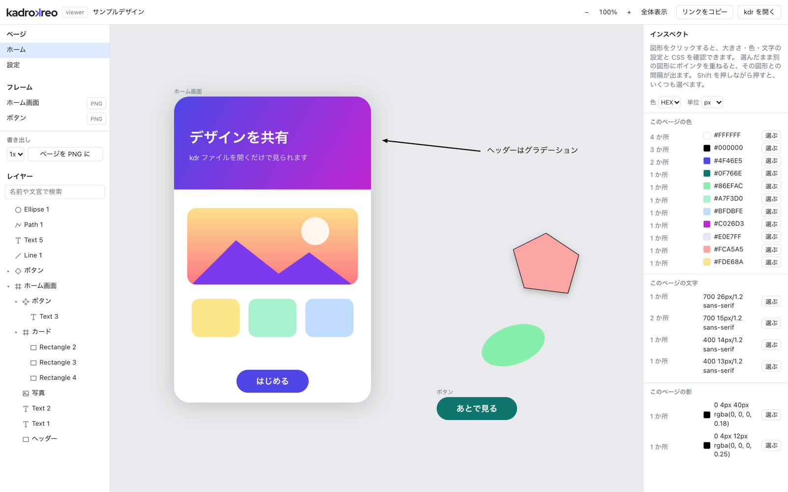
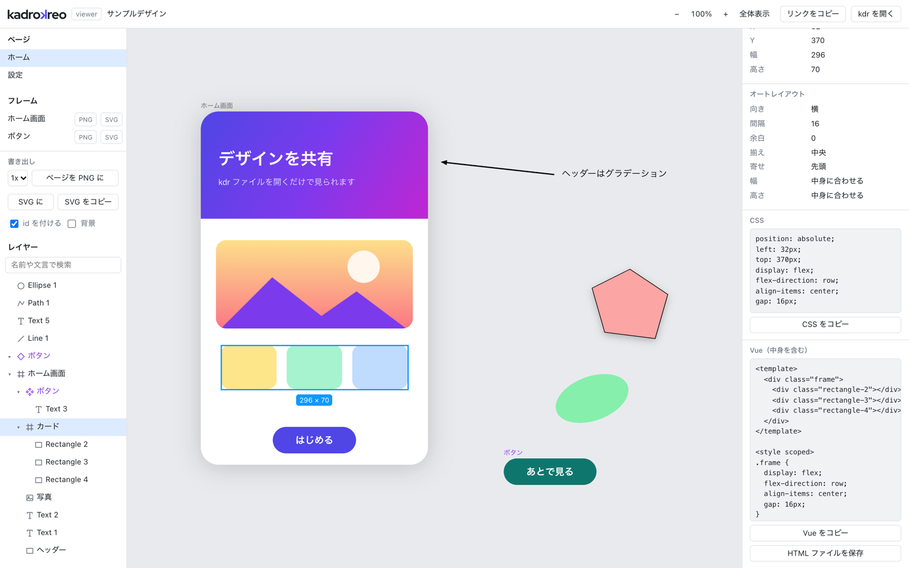

# viewer

[ユーザーズガイド](README.md) の一部。viewer は既定の起動のしかた（[入口](README.md#起動)）で使う。kdr ファイルを読み込んで見る。編集や変更はできない。

## 開く・見る・書き出す

「kdr を開く」またはウィンドウへのドロップで kdr ファイルを読み込む。ドラッグで画面を移動、`⌘`/`Ctrl` + ホイールでズーム。縮めて画面上で読めないほど小さくなった文字は、文字色の薄い帯で表す（拡大すれば文字に戻る。書き出す PNG・SVG には文字のまま入る）。
左の一覧でページを切り替えられる。ページ直下のフレームも一覧に出て、押すとそのフレームが画面に収まる。
表示中のページ全体や、フレーム 1 つを PNG（倍率は 1〜3 倍）か SVG として保存できる。「SVG をコピー」で SVG の文字をクリップボードへ入れることもできる。背景（PNG と SVG）と SVG の id は書き出し欄のチェックで選べる。ドキュメントは変更されない。

## 実装する人のための表示

viewer は、デザインを実装する人のための表示（既存のデザインツールの開発者向けモードに当たる）を兼ねていて、切り替えなしで次のことができる。

- キャンバスの図形をクリックすると選べる（ドラッグは画面の移動のまま）。ページ直下のフレームは、名前のラベルでも選べる。
  コンポーネントのインスタンスの中身や、ロックしてある図形も選べる。何もない所のクリックか `Esc` で選択を外す
- 左のレイヤー一覧からも選べる。画面に入っていないものを選ぶと、見える位置まで画面が動く。
  一覧の上の欄に打ち込むと、名前やテキストの内容で探せる（`Esc` で元の一覧に戻る）
- 選んだあとは、キーボードでレイヤーの木に沿って動ける: `Enter` で子へ、`Shift` + `Enter` で親へ、
  `Tab` / `Shift` + `Tab` で隣のきょうだいへ
- 右のパネルに、選んだものの位置・大きさ・角丸・不透明度・塗り・線・影・文字の設定・オートレイアウトの設定が出る。
  値を押すと、その値がクリップボードにコピーされる

- コンポーネントのインスタンスを選ぶと、元と違えている項目（文言・塗りなど）が、どの中身のものか分かる。
  中身を選んだときは、そのノードが違えている項目が出る。「元のコンポーネントへ移動」で元を選べる（別のページにあれば、そのページへ切り替わる）。
  元の説明文とプロパティ（元では種類と結んだノード、インスタンスではいまの値）も出る
- 選んだものを CSS で表したものも出る（「CSS をコピー」でまとめてコピー）。ふつうのフレームの子は `position: absolute`、
  自動で並べるフレームは `display: flex` になる。直線とパスは CSS では描けないので、SVG に指定するプロパティで表す
  （HTML ではパスを SVG の `path` の `d` で出し、曲線は `C`。グラデーションの塗り・線は `linearGradient` / `radialGradient`）。
  パネルの上の欄で、色の書き方（HEX / RGB / HSL）と長さの単位（px / rem）を切り替えられる。rem の基準（1rem が何 px か、既定は 16）も変えられる。
  色の書き方は、設定の一覧・CSS・ページの色の一覧のすべてに効く
- 同じ欄の「形式」で、コードの出し方を HTML + CSS・React（`style`）・React（CSS Modules）・React（Tailwind のクラス）・Vue（単一ファイルコンポーネント）から選べる。
  React の形式では、1 つのノードの欄が `style` のオブジェクトか Tailwind のクラスになり、子孫までまとめたものは JSX のコンポーネント（名前はレイヤー名から）になる。
  CSS Modules なら `styles.クラス名` を付けた JSX と、その CSS が出る。Tailwind は決まったクラスがあればそれを使い、なければ `[プロパティ:値]` で書く。
  Vue では、子孫までまとめたものが `<template>` と `<style scoped>` を並べた `.vue` ファイルの中身になる（1 つのノードの欄は CSS のまま）。
  形式も、選び直したり選択を外したりしてもそのまま（ブラウザには保存しない）

- 中身のあるフレームを選ぶと、子孫までまとめた HTML と CSS も出る（要素のクラス名はレイヤー名から作る。非表示のものは含めない）。
  画像を埋め込んだ HTML ファイルとして保存すれば、そのままブラウザで開いて見比べられる（ファイルは形式によらず HTML + CSS）。
  線は描画と同じく枠の辺の上に引き（CSS では `outline` と負の `outline-offset`）、直線・折れ線の端の形（矢印・印など）と頂点の角の丸めも SVG で出る。
  パスの破線のずれと線の角の形は `stroke-dashoffset`・`stroke-linejoin` で出る（`outline` の長方形・フレームの破線は `dashed` で、長さ・ずれ・角の形は指定できない）
- キャンバスをダブルクリックすると、そこにあるフレームが画面に収まる
- 選んだまま別の図形にポインタを重ねると、その図形との間隔が出る。親のフレームに重ねれば、4 辺までの余白が出る。
  上下（左右）に離れていれば、その向きの間隔だけが出る。線は 2 つが重なっている範囲の中央を通る
  回した図形どうしは、向きが同じ（90° の倍数の違いも含む）なら辺に沿って測る。向きが違えば、回した図形を囲む矩形（破線で出る）どうしを測る
- `Shift` を押しながら押すと、いくつも選べる（キャンバスでもレイヤー一覧でも。もう一度押すと外れる）。
  2 つ選ぶと、その間隔がキャンバスとパネルに出る。パネルには全体を囲む矩形の位置と大きさも出て、まとめて PNG・SVG に書き出せる
- 選んだものだけを PNG・SVG として保存できる。画像を選んでいれば、埋め込んである元のファイルもそのまま保存できる
- 何も選んでいないときは、そのページで使われている色と、文字の設定（CSS の `font` に書ける形）の一覧が出る。
  これも押すとコピーされる。横の「選ぶ」で、その色や文字の設定を使っている図形をまとめて選べる。
  影を使っていれば、影の一覧（CSS の `box-shadow` の値）も出る。
  色は見えているものだけを数える。塗りを重ねていれば、不透明な塗りの下に隠れた色は数えない（図形が半透明なら、下の塗りも透けて見えるので数える）。
  隠れた色は一覧に出ないので、確かめるときは図形を選んでインスペクトの「塗り」を見る（重ねた塗りを全部出す）
- 見ているページと選んでいるものは、アドレスのハッシュ（`#page=…&select=…`）に入る。「リンクをコピー」で渡せば、
  受け取った人がそのアドレスを開いて同じ kdr を開いたときに、そのページと選択から始まる（kdr そのものは URL に入らない）

どれも見ることと書き出すことだけで、ドキュメントは変更されない。
